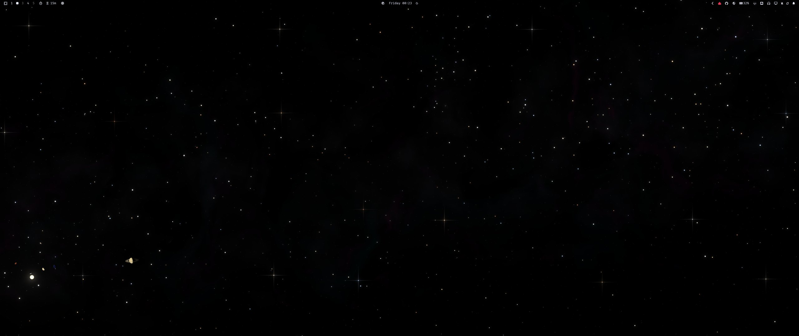
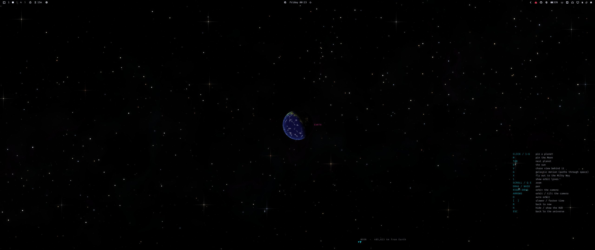

# Universe Background — an Omarchy shell plugin

A live, GPU-rendered wallpaper of the real universe for [Omarchy](https://omarchy.org).
The everyday view is a calm night sky on true black (OLED pixels stay off):
sharp stars, a soft layer of gas tinted by the theme accent, and the solar system in the lower left with the
planets where they really are today. The occasional shooting star or satellite
crosses the sky. Everything is procedural GLSL driven by a time uniform at your
display's native refresh rate, at native resolution, with no video decoding and
no loop seam.

From that view you can go further: into the solar system (live JPL orbits, a
real Earth and Moon, true-scale distances, a chase camera, the Sun's path
through the Galaxy), out to a true-scale Milky Way with 26 real places to fly to
(15 shown with real photographs), down to the event horizon of Sagittarius A* through geodesic ray
tracing, or into the real sky around Earth.



## Screenshots

| | |
|---|---|
|  |  |
| The Milky Way view: measured arms, bar and bulge, with the real places you can fly to | Earth pinned in the system view: NASA Blue/Black Marble, turned to the current sidereal time, the Moon at its real distance |
|  |  |
| The Orion Nebula: a real ESO photo shown at its true angular size, north up, from Earth's side | Sagittarius A* at 20 Schwarzschild radii: the shadow, the photon ring, the lensed sky and the Doppler-beamed flow |
|  |  |
| Sky mode, view 1: the Galactic Centre in NASA's Deep Star Maps 2020 (Gaia DR2) | The Milky Way overview with the Magellanic Clouds at their real distances |

## How it works

- Any background whose filename ends in **`-live.webp`** is rendered by the
  shader instead of being shown as a static image (the file itself serves as
  the static fallback and picker preview).
- Regular images (jpg/png/webp/gif) render exactly as before; animated GIFs
  and WebPs also animate.
- Based on Omarchy's stock `background` plugin, so double-click launcher,
  theme transitions and the reveal animation behave normally.
- The sky is brighter on an empty workspace and deep black behind windows. The
  animation pauses while a fullscreen window (a game, a video) is visible, so
  the GPU goes to that window.

## Install

Whole setup (this plugin + the matching theme + hook):

```bash
curl -sL https://gist.githubusercontent.com/vinceferro/14ca89b1f493986cff81a81721ac8670/raw/install.sh | bash
```

Plugin only:

```bash
omarchy plugin add https://github.com/vinceferro/omarchy-universe-background.git --enable
omarchy restart shell
```

Then set any `-live.webp` background (double-click the wallpaper to open the
picker). Pairs well with the
[ai-engineer theme](https://github.com/vinceferro/omarchy-ai-engineer-theme),
which ships one. The one-liner above also disables the stock
`omarchy.background` plugin, since this one takes over its job.

## The views

The explore views open only on an empty workspace, because they take the
keyboard while they are on. Esc leaves a view; so does opening a window or a
fullscreen app. `H` hides or shows the HUD in every view, and the HUD lists the
keys of the current view in its corner.

### Universe (the default)

The pointer shifts each layer by its depth. Click or scroll up over the solar
system (lower left) to enter the system view; middle double-click to fly
through the stars; left double-click elsewhere opens Omarchy's background
picker and right double-click the theme switcher.

### Flight

Middle double-click the desktop, or `omarchy-shell background navigate`.

| Key | Action |
|---|---|
| `W` / `S` | thrust forward / back |
| `A` / `D` | strafe left / right |
| `R` / `F` | up / down |
| `Esc` | back to the universe |

### Solar system

Click or scroll up over the solar system, or `omarchy-shell background system`.
Positions come from the real date using JPL's approximate Keplerian elements
(Standish, valid 1800-2050), so the planets, Earth's rotation and the Moon are
where they are right now. The overview squeezes the orbits so they fit on
screen; pinning a planet or the Moon (and staying zoomed in) blends the whole
system to true scale: real orbit distances, real radii, the real Sun.

| Key | Action |
|---|---|
| click / `1`-`6` | pin a planet (Mercury to Saturn) |
| `M` | pin the Moon |
| `Tab` / `Shift+Tab` | next / previous body |
| `0` | the Sun |
| `V` | chase view behind the pinned body |
| `G` | galactic motion: the Sun's path through space |
| `X` | fly out to the Milky Way |
| `L` | show / hide orbit lines (off by default) |
| scroll / `Q` `E` | zoom (zooming all the way out returns to the universe) |
| drag / `W` `A` `S` `D` | pan |
| right-drag / arrows | orbit / tilt the camera |
| `O` | auto orbit |
| `[` `]` | slower / faster time (live, 1 min/s, 1 hour/s ... 1 year/s) |
| `N` | back to now |
| `Esc` | back to the universe |

**Chase view** (`V` with a body pinned): a 3D camera ray-traces the scene from
behind the pinned planet or the Moon, looking toward the Sun along the
body-Sun line. Bodies are at their real sizes and distances.

| Key | Action |
|---|---|
| `X` | lock on the Sun vector / angled view |
| `E` | look toward Earth instead of the Sun (from Earth: always the Sun) |
| right-drag | swing the camera |
| scroll | slide along the vector |
| `Tab` / `1`-`6` / `M` | chase another body |
| `[` `]`, `N` | time rate, back to now |
| `V` / `Esc` | back to the system view |

**Galactic motion** (`G`): the solar system drawn in the Galaxy's rest frame.
The Sun travels at 249 km/s toward Cygnus and each planet leaves the trail of
where it has really been: stretched helices around the Sun's straight path,
with the orbital plane tilted 61 degrees to the direction of travel.

| Key | Action |
|---|---|
| `-` `=` | slow the Sun down (1/2 ... 1/200) so the coils show; the HUD says by how much |
| `L` | show / hide the 2-year trails |
| right-drag / arrows | swing / tilt the camera |
| scroll | camera distance |
| `[` `]`, `N` | time rate, back to now |
| `G` / `Esc` | back to the system view |

### Milky Way

`X` from the system view, or `omarchy-shell background milkyway`. A volumetric
model of our Galaxy at true scale, in kiloparsecs: the spiral arms measured
by Reid et al. 2019, the long bar at 27 degrees to the Sun-Centre line, the
boxy bulge, the dust lanes, with Andromeda, Triangulum and the Magellanic
Clouds at their real distances, sizes and tilts. Exposure adapts like an eye:
dimmer inside the disk and much dimmer in the crowded bulge.

26 real places are marked, with distances checked against Gaia and VLBI
catalogues: nebulae (Orion, Carina, Eagle, Lagoon, Rosette, Crab, Ring,
Helix, Gum, Cygnus X), clusters (Pleiades, Hyades, Westerlund 1, Omega
Centauri, 47 Tucanae), stars (Betelgeuse, Alpha Centauri, Sirius, Vega,
Polaris), the Magellanic Clouds, the Sagittarius Dwarf, Andromeda, Triangulum
and Sagittarius A*. Fifteen of them have a real photograph (see
[textures/CREDITS.md](textures/CREDITS.md)): fly there and you approach from
Earth's side, the way the photo was taken, and the image is shown at its true
angular size, north up. Near the Sun the model blends into the real sky.

| Key | Action |
|---|---|
| `Tab` / `Shift+Tab` | next / previous place |
| click | fly to the place under the pointer |
| `0` | back to the Sun |
| `B` | the black hole at the centre; `B` again dives to 20 Schwarzschild radii |
| drag / arrows | orbit the camera |
| scroll / `Q` `E` | closer / farther |
| `W` `A` `S` `D` | fly freely, level with the disk |
| `[` `]` | time-lapse: the Galaxy turns (100,000 years/s up to 20 million years/s) |
| `N` | back to now |
| `Esc` | back to the universe |

The time-lapse turns the disk around Sagittarius A* at the Sun's angular
speed, one lap in about 203 million years, with the Sun bobbing through the
plane. It is simplified: the whole disk turns as one, whereas real disks
shear, and the HUD says so.

### Sagittarius A*

`B` in the Milky Way view (scrolling in goes down to 6 Schwarzschild radii).
Every pixel's light ray is traced backward through the curved spacetime of a
Schwarzschild black hole of 4.3 million solar masses: the shadow at 2.6 Rs,
the photon ring, the stars and the Galaxy's glow lensed around it. The gas is
a thin, hot flow orbiting at the local circular speed, Doppler-beamed on the
approaching side and reddened and dimmed by gravitational redshift deep in
the well, its spin axis about 30 degrees off the line of sight as the EHT
2022 image and GRAVITY's flare loops suggest.

The colours are a false-colour impression. The real flow around Sgr A* emits
mostly in radio and infrared and is far too faint to see by eye; visible
light does not reach us through the dust at all. The gas motion is also
sped up 30 times so an orbit at the innermost stable radius takes about a
minute rather than half an hour.

### Sky mode

`omarchy-shell background sky` (or `skyView <1-7>`). The real sky around
Earth from NASA SVS Deep Star Maps 2020 (Hipparcos-2, Tycho-2 and Gaia DR2)
in galactic coordinates, a true camera projection you can look around in.
Seven named views match the static 5K wallpapers made by
`tools/make_sky_views.py`; when the camera sits exactly on one and that
render exists in `~/.local/share/universe-background/sky/`, it fades in at
native resolution.

| View | Centre (l, b) |
|---|---|
| 1 Milky Way core | 0.0, -1.5 |
| 2 Cygnus Rift | 78.0, 1.0 |
| 3 Aquila, Scutum | 28.0, -1.5 |
| 4 Carina, Southern Cross | 295.0, -1.0 |
| 5 Magellanic Clouds | 291.0, -38.0 |
| 6 Centaurus, Norma | 320.0, -0.5 |
| 7 Scorpius, Ophiuchus | 353.0, 16.0 |

| Key | Action |
|---|---|
| `1`-`7` / `Tab` / `Shift+Tab` | the named views |
| drag / arrows (or `W` `A` `S` `D`) | look around |
| scroll / `Q` `E` | zoom (8 to 130 degrees) |
| `Esc` | back to the universe |

### Suggested shortcuts

Bindings live in your Hyprland config, not in the plugin. The views only open
on an empty workspace, so a small helper that first jumps to one is handy;
save this as `~/.local/bin/universe-explore`:

```bash
#!/bin/bash
# Open a view of the live wallpaper, jumping to an empty workspace first.
ws=$(hyprctl activeworkspace -j)
if (( $(jq .windows <<<"$ws") > 0 )); then
  used=$(hyprctl workspaces -j | jq -c '[.[] | select(.windows > 0) | .id]')
  target=""
  for id in {1..10}; do
    if jq -e "index($id) == null" <<<"$used" >/dev/null; then
      target=$id
      break
    fi
  done
  [[ -z $target ]] && exit 0
  hyprctl eval "hl.dispatch(hl.dsp.focus({workspace=$target}))" >/dev/null
  sleep 0.4
fi
omarchy-shell background "${1:-system}"
```

Then in `~/.config/hypr/bindings.conf`:

```ini
bindd = SUPER ALT, U, Solar system, exec, universe-explore system
bindd = SUPER ALT, Y, Milky Way, exec, universe-explore milkyway
bindd = SUPER ALT, K, Real sky, exec, universe-explore sky
bindd = SUPER ALT, J, Wallpaper HUD, exec, omarchy-shell background toggleHud
```

## IPC

Everything is reachable through the shell's IPC, `omarchy-shell background <function> [args]`:

| Function | Effect |
|---|---|
| `universe` | back to the default view |
| `navigate` | toggle flight |
| `system` | toggle the solar system view |
| `focus <0-7>` | pin a body: 0 the Sun, 1-6 Mercury to Saturn, 7 the Moon (opens the system view if needed) |
| `chase` | toggle the chase view behind the pinned body |
| `align <true/false>` | chase camera exactly on the body-Sun line, or angled |
| `look <sun/earth>` | what the chase camera looks toward |
| `galactic` | the galactic-motion view (opens the system view if needed) |
| `milkyway` | the Milky Way view |
| `fly <place>` | fly to a place by name prefix (`"Orion"`, `"Sagittarius A"`, `"Andromeda"`; `sun` for the Sun) |
| `sky` | Sky mode, at the last view |
| `skyView <1-7>` | Sky mode at a named view |
| `hud <0..1>` | HUD brightness until the shell restarts (default 0.38) |
| `toggleHud` | hide / show the HUD; hidden is remembered across restarts |
| `refresh`, `set <path>`, `setInstant <path>`, `transition <from> <to>`, `themeTransition ...` | the stock background plugin's functions, unchanged |

## Real data and accuracy

What is real:

- **Planets**: positions from JPL's approximate Keplerian elements at J2000
  with their rates per century, solved for the real date (also when the
  system view steps time forward). Rotation periods and radii are real.
- **Earth**: NASA Blue Marble (day) and Black Marble (night), turned to the
  current Greenwich sidereal angle with the axial tilt, and a marker at the
  author's home. **Moon**: the LRO map, placed by a low-precision geocentric
  ephemeris, 27% of Earth's radius at about 60 Earth radii once at true scale.
- **The Sun's motion**: 249 km/s toward Cygnus (Reid & Brunthaler 2020,
  Schoenrich et al. 2010), with the orbital planes' tilts and nodes from JPL.
- **Milky Way**: arm geometry from Reid et al. 2019, bar and bulge from Wegg
  et al. 2013/2015 and Bland-Hawthorn & Gerhard 2016, dust from Drimmel &
  Spergel 2001, measured scale heights, R0 = 8.15 kpc. Place positions from a
  catalogue checked against Gaia and VLBI distances; the HUD gives distance,
  size and light travel time. Andromeda and Triangulum reuse the disk model at
  their real distances and orientations.
- **Photos**: 15 real images, shown at the published field of view, north
  up, from Earth's direction.
- **Sky**: NASA SVS Deep Star Maps 2020 (Gaia DR2), the Milky Way core in the
  everyday view, the full sky near the Sun in the Milky Way view and in Sky
  mode, and 1:1 pixels in the seven named views.
- **Sagittarius A***: Schwarzschild light bending (photon sphere at 1.5 Rs,
  shadow edge at 2.6 Rs), Doppler beaming and gravitational redshift, mass
  4.3 million Suns, 26,600 ly away.

What is simplified or invented:

- The overview compresses the orbits a thousandfold so the system fits on
  screen; true scale only when a body is pinned and zoomed in.
- The Moon's position is a low-precision series, not a full ephemeris.
- The Milky Way's small-scale structure (clumps, HII knots, dust filaments)
  is noise laid along the measured arms; the time-lapse turns the disk as one
  body.
- The Sun's vertical bobbing through the plane is an approximation fitted to
  today's height and velocity.
- Sgr A* is drawn as a non-spinning (Schwarzschild) hole; the gas colours are
  a false-colour impression and its motion runs 30 times faster than real.
- The soft gas layer of the everyday sky and the far galaxies are procedural
  and theme-tinted; the stars are procedural too, except where the real sky
  map shows through.

## Performance

Measured on an RTX 3080 Ti driving 5120x2160 at 165 Hz:

- live background with the animated sky: about 160-180 W board power (it
  pauses while a fullscreen window is visible);
- Milky Way overview: about 140 W;
- near the black hole: about 300 W (the ray tracer runs at half resolution
  only while the camera is near the hole).

The soft sky layer re-renders about ten times a second at half resolution;
the Milky Way volume renders at a third of the screen size and only when the
camera moves. The HUD gauges read CPU, memory and (through `nvidia-smi`) GPU
load every two seconds while the HUD is visible.

## Tools and rebuilding assets

All generated textures are in the repo; the scripts in `tools/` rebuild them.
They need `numpy` and `Pillow`; the sky scripts also need `OpenEXR`. Run them
with `python3 -I`.

The 16k source sky map (384 MB) is not in the repo. Download
`starmap_2020_16k_gal.exr` from <https://svs.gsfc.nasa.gov/4851>, then:

```bash
# textures/sky-full.jpg (the full sky, for Sky mode and the galaxy view near the Sun)
python3 -I tools/make_sky.py /path/to/starmap_2020_16k_gal.exr

# the seven 5120x2160 static wallpapers of the named sky views
python3 -I tools/make_sky_views.py /path/to/starmap_2020_16k_gal.exr ~/.local/share/universe-background/sky/
```

Sky mode fades those renders in when the camera rests on a named view. To use
them as ordinary wallpapers in Omarchy's picker, symlink them into a theme's
backgrounds folder:

```bash
ln -s ~/.local/share/universe-background/sky/*.jpg ~/.config/omarchy/backgrounds/<theme>/
```

Other assets:

```bash
# textures/milkyway-young.png and milkyway-dust.png from the published arm, bar and dust measurements
python3 -I tools/gen_milkyway.py 2048

# textures/photos.jpg and photos.json from the source photos (img1.jpg ... in a download dir; URLs in textures/CREDITS.md)
python3 -I tools/make_atlas.py /path/to/downloads
```

## Credits

All imagery is real data used under its licence: NASA SVS, NASA Earth
Observatory, LRO, ESO, NOIRLab, Hubble and Webb images, and the Gaia
catalogue by ESA/Gaia/DPAC. The full list with licences and source links is in
[textures/CREDITS.md](textures/CREDITS.md).

## Tuning

The shaders are readable GLSL: `universe.frag` (stars, solar system, chase
view, HUD, lensing), `nebula.frag` (the soft sky), `galaxy.frag` (the Milky
Way volume) and `hole.frag` (the black hole). Edit, then recompile the one you
changed and restart the shell:

```bash
/usr/lib/qt6/bin/qsb --glsl 100es,120,330 --hlsl 50 --msl 12 -o universe.qsb universe.frag
omarchy restart shell
```

Same command for `galaxy`, `hole` and `nebula`. If your edits don't appear,
clear Qt's shader cache: `rm -rf ~/.cache/quickshell`.

Other knobs are plain properties at the top of `Background.qml`: the home
marker (`homeLat`, `homeLon`), the HUD brightness (`hudBrightness`), the
time rates, and the list of places (`hotspots`).

## Notes

- The fragment shaders read `qt_TexCoord0` (the default vertex shader's output
  name); renaming it causes name-mismatch linkage bugs on some drivers.
- The GPU gauge in the HUD uses `nvidia-smi`; on other GPUs it stays at zero.
- A hidden HUD is remembered in `~/.local/state/universe-background/hud-hidden`.

## License

MIT (code). Imagery: see [textures/CREDITS.md](textures/CREDITS.md).
