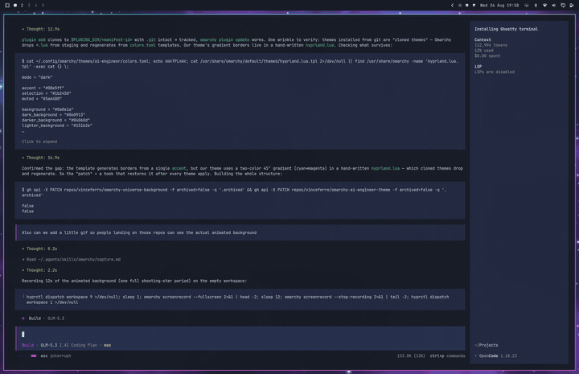
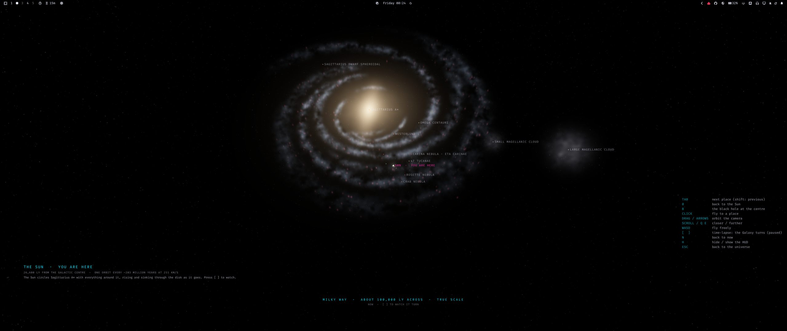

# Live Background — shader-animated wallpapers for Omarchy

An [Omarchy](https://omarchy.org) shell plugin that renders certain
backgrounds on the GPU with a GLSL fragment shader, inside the shell's own
background layer — no mpv, no swww, no extra processes. Animation runs at
your display's **native refresh rate** (120 Hz stays 120 Hz) at full native
resolution.



## How it works

- Any background whose filename ends in **`-live.webp`** is rendered by the
  shader instead of being shown as a static image. The file itself still
  serves as the static fallback and the picker thumbnail.
- Regular images (jpg/png/webp/gif) render exactly as before.
- Drop-in fork of Omarchy's stock `background` plugin: the double-click
  picker, theme transitions and the reveal animation behave unchanged.
- The shader is created through a `Loader` and driven by a wall-clock
  `Timer` — details in `Background.qml` comments; both work around
  Quickshell/Qt quirks where hidden shader effects stop updating.

## Bundled example: universe

The shader this repo ships is a procedural universe — drifting nebula,
starfields clustered into agglomerates with a milky-way band, shimmering
galaxies, energy ribbons and the occasional shooting star (gif above, still
below). Every `-live.webp` background is rendered by it; the image content
only matters for the fallback.



It pairs with the
[ai-engineer theme](https://github.com/vinceferro/omarchy-ai-engineer-theme),
which ships a `1-universe-live.webp` background.

## Install

Whole setup (this plugin + the matching theme + hook):

```bash
curl -sL https://gist.githubusercontent.com/vinceferro/14ca89b1f493986cff81a81721ac8670/raw/install.sh | bash
```

Just the plugin:

```bash
omarchy plugin add https://github.com/vinceferro/omarchy-universe-background.git --enable
omarchy plugin disable omarchy.background   # the stock background, replaced by this
omarchy restart shell
```

Then set any `-live.webp` background (double-click the wallpaper to open
the picker). Updates: `omarchy plugin update universe.background`.

## Ship your own shader

The plugin renders all `-live.webp` backgrounds with `universe.qsb`. To ship
a different look, edit `universe.frag` and recompile:

```bash
# qt6-shadertools provides qsb; the default variant set fails to link on
# Mesa/aarch64, so pin the GLSL versions explicitly
qsb --glsl "100 es,120,330" universe.frag -o universe.qsb
omarchy restart shell
```

Useful conventions from the frag: a `time` uniform (seconds, wraps at 600 —
keep `sin()` arguments small via a mod-2π wrapper for float32 precision) and
a `resolution` uniform. If your edits don't appear, clear Qt's shader cache:
`rm -rf ~/.cache/quickshell`.

## Notes

- ~6–10% CPU for the whole shell on an ARM laptop; rendering itself is GPU-side.
- The fragment shader must read `qt_TexCoord0` (the default vertex shader's
  output name) — renaming it causes linkage failures on some drivers.

## License

MIT
