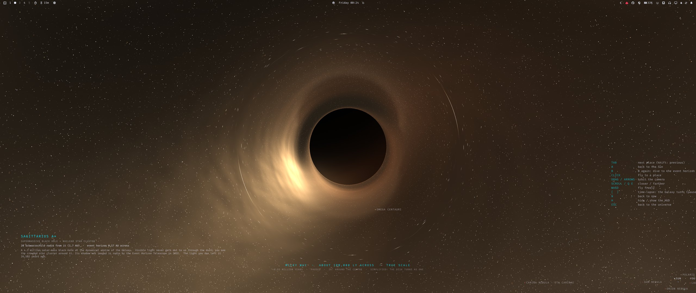
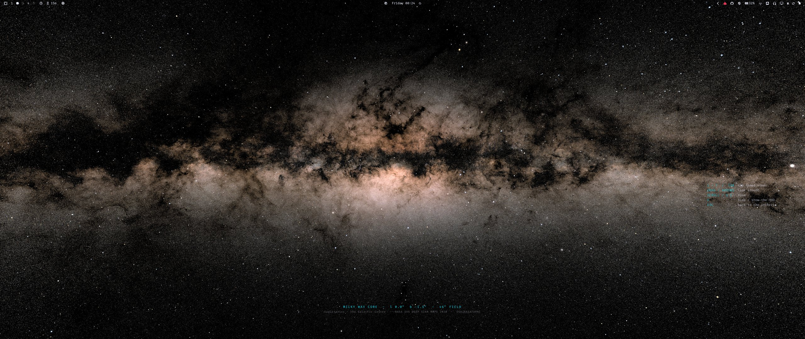

# Universe Background — an Omarchy shell plugin

A live, GPU-rendered wallpaper of the real universe for [Omarchy](https://omarchy.org).
The everyday view is a calm night sky on true black (OLED pixels stay off):
sharp stars, a soft layer of gas tinted by the theme accent, and the solar system in the lower left with the
planets where they really are today. The occasional shooting star or satellite
crosses the sky. Everything is procedural GLSL driven by a time uniform at your
display's native refresh rate, at native resolution (or a share of it the GPU
can carry, see [Adaptive quality](#adaptive-quality)), with no video decoding and
no loop seam.

From that view you can go further: into the solar system (live JPL orbits, a
real Earth and Moon, true-scale distances, a chase camera, the Sun's path
through the Galaxy), out to a true-scale Milky Way with 26 real places to fly to
(16 shown with real photographs) and the Local Group around it (Andromeda and
Triangulum from their own photos, the Magellanic Clouds as volumes, 72 dwarf
galaxies), down to the event horizon of Sagittarius A* through geodesic ray
tracing, or into the real sky around Earth.


## Screenshots

| | |
|---|---|
|  |  |
| The Milky Way view: measured arms, bar and bulge, with the real places you can fly to | Earth pinned in the system view: NASA Blue/Black Marble, turned to the current sidereal time, the Moon at its real distance |
|  |  |
| The Orion Nebula: a real ESO photo shown at its true angular size, north up, from Earth's side | Sagittarius A* at 20 Schwarzschild radii: the shadow, the photon ring, the lensed sky and the Doppler-beamed flow |
|  |  |
| Sky mode, view 1: the Galactic Centre in NASA's Deep Star Maps 2020 (Gaia DR2) | The Milky Way overview with the Magellanic Clouds at their real distances |

## How it works

- Any background whose filename ends in **`-live.webp`** is rendered by the
  shader instead of being shown as a static image (the file itself serves as
  the static fallback and picker preview).
- Regular images (jpg/png/webp/gif) render exactly as before; animated GIFs
  and WebPs also animate.
- Based on Omarchy's stock `background` plugin, so double-click launcher,
  theme transitions and the reveal animation behave normally.
- The sky is brighter on an empty workspace and deep black behind windows. The
  animation pauses while a fullscreen window (a game, a video) is visible, so
  the GPU goes to that window.
- The solar system has one camera (`lib/camera.js`): the overview, a pinned
  body, the chase and galactic views and the small system in the universe view
  are the same orbit camera, moved by one critically damped spring per channel
  and by van Wijk & Nuij flights. The shader, picks, labels and markers all
  share its projection, so what you click is where it is drawn.

## Install

Whole setup (this plugin + the matching theme + hook):

```bash
curl -sL https://gist.githubusercontent.com/vinceferro/14ca89b1f493986cff81a81721ac8670/raw/install.sh | bash
```

Plugin only:

```bash
omarchy plugin add https://github.com/vinceferro/omarchy-universe-background.git --enable
omarchy plugin disable omarchy.background   # the stock background, replaced by this
omarchy restart shell
```

Updates: `omarchy plugin update universe.background`.

Then set any `-live.webp` background (double-click the wallpaper to open the
picker). Pairs well with the
[ai-engineer theme](https://github.com/vinceferro/omarchy-ai-engineer-theme),
which ships one. The one-liner above also disables the stock
`omarchy.background` plugin, since this one takes over its job.

## The views

The explore views open only on an empty workspace, because they take the
keyboard while they are on. Esc leaves a view; so does opening a window or a
fullscreen app. `T` sets how much text is on the scene and `H` switches the
cockpit in every view (see [Text](#text)); at the full level the keys of the
current view are listed at the bottom left.

### Text

One setting, the text level, decides every word and line drawn over the
scene. `T` cycles it while exploring (`Shift+T` goes back):

| Level | Shows |
|---|---|
| `off` | the scene, nothing else |
| `names` | what you are looking at: place and planet names, markers, the chosen place's name and facts, a caption's title |
| `full` | names, plus the guide (the place's blurb, caption detail, the key hints) and the cockpit (the HUD's rings, clock, readouts and beacons) |

`H` (and Super+Alt+J, which also works in the universe view) switches the
cockpit: between `full` and the last level below it. The level is remembered
across restarts. Changing it names the new level for a moment where the
caption goes.

Text comes up with any interaction (a key, the pointer, the wheel, a flight)
and fades once it has had time to be read: 8 s, plus a second for every 3.5
words, 40 s at most. So a name goes after 8 s, a place's card after about
25, the key list after about 30, and a view left parked puts no standing text
on the OLED; any key brings it back (for a screenshot outside film mode,
press one first). A fall into the black hole holds its own text up until it
ends. The one standing exception is the cockpit's rings, clock and readouts,
which stay while the level is `full`: they are dim and drift.

Where text goes is computed from the screen (`lib/layout.js`). Nothing leaves
the safe rect: the screen less the bar (Hyprland's reserved bands), a camera
notch (the platform's `display-cutouts.json`, across the whole width, bar or
no bar) and a margin. Inside it the chosen place's card stands on the key
hints in one column at the bottom left, the mode caption stands at the bottom
centre, and the HUD is sized and placed by the aspect: right of centre with
its readouts beside it on a wide screen, smaller and in the top right corner
with the readouts under it on a narrow one. Scene names go to the right of
their thing, else to the left, else their words hide (the dot stays): clear
of the bar and notch, the card, the caption, the HUD and each other. The
chosen or hovered thing always shows its name, and the HUD dims while that
thing is inside its ring.

### Universe (the default)

The pointer shifts each layer by its depth. Click or scroll up over the solar
system (lower left) to enter the system view; middle double-click to fly
through the stars; left double-click elsewhere opens Omarchy's background
picker and right double-click the theme switcher.

### Flight

Middle double-click the desktop, or `omarchy-shell background navigate`.

| Key | Action |
|---|---|
| `W` / `S` | thrust forward / back |
| `A` / `D` | strafe left / right |
| `R` / `F` | up / down |
| `Esc` | back to the universe |

### Solar system

Click or scroll up over the solar system, or `omarchy-shell background system`.
Positions come from the real date using JPL's approximate Keplerian elements
(Standish, valid 1800-2050), so the planets, Earth's rotation and the Moon are
where they are right now. The overview squeezes the orbits so they fit on
screen; pinning a planet or the Moon blends the whole system to true scale
during the flight to it: real orbit distances, real radii, the real Sun. A
pick is one continuous move that lands with the body centred at its final
size; any input mid-flight takes over from the current motion. Zooming out
past the overview's framing returns to the squeezed layout.

| Key | Action |
|---|---|
| click / `1`-`6` | pin a planet (Mercury to Saturn) |
| `M` | pin the Moon |
| `Tab` / `Shift+Tab` | next / previous body |
| `0` | the Sun |
| `V` | chase view behind the pinned body |
| `G` | galactic motion: the Sun's path through space |
| `X` | fly out to the Milky Way |
| `I` | show / hide orbit lines (off by default) |
| `T` / `Shift+T` | text level: off, names, full (see [Text](#text)) |
| scroll / `Q` `E` | zoom about the point under the pointer, or about the pinned body (zooming all the way out returns to the universe) |
| drag / arrows | orbit / tilt the camera about what it is looking at (half a screen height of drag is a right angle; a release coasts) |
| right-drag (or Shift-drag) / `W` `A` `S` `D` | pan: the ecliptic sticks to the pointer and coasts on release (this unpins the body) |
| `O` | auto orbit |
| `[` `]` | slower / faster time (live, 1 min/s, 1 hour/s ... 1 year/s) |
| `N` | back to now |
| `Esc` | back to the universe |

**Chase view** (`V` with a body pinned): two-point framing. The same camera
dolly-zooms to a 53-degree field (the pinned body keeps its size) and sits
behind a foreground body A, looking along the line to a target B, with A
centred and B in frame. B is the Sun by default; click another body or press
`E` to look along the line to it, `R` to stand behind the other one. The
camera's yaw rides the A-B direction, so the pair stays framed as they orbit.
Bodies are at their real sizes and distances.

| Key | Action |
|---|---|
| `X` | lock the eye exactly on the A-B line / angled over-the-shoulder view |
| `E` / click | look toward another body (the next one, or the one clicked) |
| `R` | swap A and B: stand behind the target, looking back |
| drag / arrows | swing the camera |
| scroll / `Q` | closer / farther along the vector |
| `Tab` / `0`-`6` / `M` | chase another body (`0`: the Sun) |
| `[` `]`, `N` | time rate, back to now |
| `V` / `Esc` | back to the system view (the overview's angle is restored) |

**Galactic motion** (`G`): the solar system drawn in the Galaxy's rest frame.
The Sun travels at 249 km/s toward Cygnus and each planet leaves the trail of
where it has really been: stretched helices around the Sun's straight path,
with the orbital plane tilted 61 degrees to the direction of travel.

| Key | Action |
|---|---|
| `-` `=` | slow the Sun down (1/2 ... 1/200) so the coils show; the HUD says by how much |
| `I` | show / hide the 2-year trails |
| `V` | look back from just ahead of the Sun along its path (again: the side view) |
| drag / arrows | swing / tilt the camera |
| scroll / `Q` `E` | camera distance |
| `[` `]`, `N` | time rate, back to now |
| `G` / `Esc` | back to the system view |

### Milky Way

`X` from the system view, or `omarchy-shell background milkyway`. A volumetric
model of our Galaxy at true scale, in kiloparsecs: the spiral arms measured
by Reid et al. 2019, the long bar at 27 degrees to the Sun-Centre line, the
boxy bulge, the dust lanes, and the Local Group around it at real distances,
sizes and tilts: Andromeda and Triangulum as thin disks unfolded from their
own photos (Andromeda with its 10 kpc ring of young stars and its ellipticals
M32 and NGC 205 beside it), the Large Magellanic Cloud as a barred, lopsided
disk, the Small one as an irregular body stretched along our line of sight,
and 72 dwarf galaxies from McConnachie 2012 as faint glows, each as bright as
its magnitude says. Exposure adapts like an eye: dimmer inside the disk and
much dimmer in the crowded bulge.

A galaxy with a photo hands over by view angle: within 14 degrees of Earth's
line of sight you see the photo, past 32 degrees the 3D model, a cross-fade
between (the model is unfolded from the same photo, so they match where they
meet). The dwarfs are places too: hover to find one (its marker and name
appear under the pointer, or once it is big on screen), click to fly there.
`V` stands you at Andromeda's edge (35 kpc out, on our side, so its own light
is behind you) looking back at the Milky Way, a spindle 2.7 degrees long, 21
degrees from edge-on, seen from the south.

26 real places are marked, with distances checked against Gaia and VLBI
catalogues: nebulae (Orion, Carina, Eagle, Lagoon, Rosette, Crab, Ring,
Helix, Gum, Cygnus X), clusters (Pleiades, Hyades, Westerlund 1, Omega
Centauri, 47 Tucanae), stars (Betelgeuse, Alpha Centauri, Sirius, Vega,
Polaris), the Magellanic Clouds, the Sagittarius Dwarf, Andromeda, Triangulum
and Sagittarius A*. Sixteen of them have a real photograph (see
[textures/CREDITS.md](textures/CREDITS.md)): fly there and you approach from
Earth's side, the way the photo was taken, and the image is shown at its true
angular size, north up. Near the Sun the model blends into the real sky.

| Key | Action |
|---|---|
| `Tab` / `Shift+Tab` | next / previous place |
| click | fly to the place under the pointer |
| `0` | back to the Sun |
| `B` | the black hole at the centre; `B` again goes down to 6 Schwarzschild radii on its spin axis, and parked there `B` (or one more scroll in) lets go and falls in |
| `K` | mathematics mode on / off: the fall follows the extended Kerr solution through the ring into the other universe (not physics; takes effect at the next fall) |
| `V` | the Milky Way from Andromeda (scroll in to cross the gap along that line) |
| `T` / `Shift+T` | text level: off, names, full (see [Text](#text)) |
| drag / arrows | orbit the camera (falling into the hole: look around) |
| scroll / `Q` `E` | closer / farther |
| `W` `A` `S` `D` | fly freely, level with the disk |
| `[` `]` | time-lapse: the Galaxy turns (100,000 years/s up to 20 million years/s) |
| `N` | back to now |
| `Esc` | back to the universe |

The time-lapse turns the disk around Sagittarius A* at the Sun's angular
speed, one lap in about 203 million years, with the Sun bobbing through the
plane. It is simplified: the whole disk turns as one, whereas real disks
shear, and the HUD says so.

### Sagittarius A*

`B` in the Milky Way view (scrolling in goes down to 6 Schwarzschild radii).
Every pixel's light ray is traced backward through the curved spacetime of a
spinning (Kerr) black hole of 4.3 million solar masses, in Kerr-Schild
coordinates (`hole.frag`; the same march in JS with its tests in
`lib/kerr.js`): the shadow, the photon ring, the stars and the Galaxy's glow
lensed around it, the twist that frame dragging gives the lensed sky, and the
flattening of the shadow's one side at high spin, all from the tracing,
nothing painted. The spin is a/M = 0.94, the Event Horizon Telescope's 2022
best-bet model for Sgr A* (a magnetically arrested flow seen 30 degrees from
its axis; Daly et al. 2024 find about 0.9 another way, Fragione & Loeb 2020
argue for under 0.1 from the S stars' orbits): it is not measured, one number
in `Background.qml` (`holeSpin`) changes it, and 0 gives the Schwarzschild
hole this replaced. Its horizons are at 0.67 and 0.33 Rs; the shadow's edge
is found in closed form at full resolution from the ray's constants of
motion (the critical points of the Kerr radial potential), so it stays
crisp. The gas is a thick, hot torus on prograde Kerr circular orbits
(Bardeen, Press & Teukolsky 1972) down to the innermost stable orbit at
1.01 Rs, each sample's shift the one dot product of the ray's and the gas's
4-velocities: Doppler beaming on the approaching side, gravitational
redshift deep in the well, frame dragging. The spin axis is about 30 degrees
off the line of sight from the Sun's side, as the EHT image and GRAVITY's
flare loops suggest, so the D-shaped flattening is subtle from there; orbit
the camera round to the equator to see it in full.

The colours are a false-colour impression. The real flow around Sgr A* emits
mostly in radio and infrared and is far too faint to see by eye; visible
light does not reach us through the dust at all. The gas motion is also
sped up 30 times so an orbit at the innermost stable radius takes about a
minute rather than half an hour. Where both sides of the torus lie on one
ray (the photon ring) the hue is the mean shift's, not the mix.

**The fall.** `B` flies to the hole and `B` again down to 6 Rs on the spin
axis (the descent steers to the pole on the camera's side); parked there,
`B` lets go (so does one more scroll in, and so does free flight that
carries the camera below the horizon: there is no flying through; if the
camera was dragged off the pole it glides there first). The camera is then
in free fall down the axis from rest at 6 Rs (`lib/fall.js`): the way down
to the polar photon orbit (1.25 Rs) is shown 45 times faster than real, the
last stretch to the outer horizon in 4 s, and the inside at the true rate,
14.9 s of proper time between the two horizons (28.7 s to the singularity
for a non-spinning hole, which `holeSpin = 0` still gives). The ray tracer
takes the falling observer's frame: aberration shrinks the shadow, and once
inside the dark fills the half of the sky toward the centre while the
outside squeezes into an ever thinner, blueshifted band, red and dim
straight behind. Nothing marks the outer horizon but the HUD. Nothing
steers on the way down, but drag or the arrows look around (right looks
right, up looks up; all the way round, short of straight up or down): back
at the hole, or up at the shrinking sky. Only the camera turns; the fall
stays on the axis, and the ray tracer's frame with it. After a few seconds
without input the view eases back to the scripted one, which turns from the
hole to the side so that at the horizon the dark is below and the sky above.

The fall ends at the inner (Cauchy) horizon, because the physics does: the
Kerr solution continues through it, but a real hole's inner horizon is
unstable (Penrose 1968; Poisson & Israel 1990, "mass inflation"; Ori 1991):
light falling in after us arrives there blueshifted without bound, and what
the solution says beyond it describes nothing observed. In the last second
the glow below brightens and turns blue-white (a labelled cartoon of that),
the screen fades to black, holds two seconds, and the camera is back beside
the Sun. Esc gives up the same way; nothing leaves the camera inside the
hole. The HUD names the phase and counts the proper time left; `status`
reports both; the maths has its own checks in `tests/test_fall.js` and
`tests/test_kerr.js`.

**Mathematics mode** (`K`, or `mathMode true` over IPC; off by default, not
remembered, takes effect at the next fall). What the maximally extended Kerr
solution says, followed past where physics stops: through the inner horizon,
through the disk inside the ring singularity (on the axis the ring is never
touched; r passes through 0 to r < 0) into the negative-r sheet, an
asymptotically flat universe where the hole's gravity repels. The view there
is traced like everything else, in the r < 0 sheet: our own sky through the
throat inside the ring, and around it the other universe's sky, which the
solution says nothing about and which is therefore plainly invented (sparse,
cold violet-white and amber stars, no Milky Way). The camera is pushed away
(the repulsion is gentle: 444 s of proper time to -10 Rs, shown in 20 s), and
then the usual fade returns to the Sun. One honesty the maths forces: an
observer from rest at 6 Rs can never get there. The potential peaks at
r = -a with 1 + M/a > E^2, so a from-rest fall turns back inside the inner
horizon at r = a^2/r0 = 0.037 Rs and is thrown out into a new positive-r
universe instead; reaching r < 0 needs E >= sqrt(1 + M/a) = 1.44, and the
mode starts with E = 1.5, an impossible shove of 0.75 c down the axis. The
HUD, the card and `status` all say so.

**What you see below you.** The dark toward the centre, the shadow from
outside and the whole lower half of the sky once inside, is not quite black:
it holds the faint light of gas that fell in ahead of us. Outside the horizon
that light climbs up to us from below. Inside, where nothing climbs, it is
light the gas sent while it was still above where we are now, and we catch it
because we fall faster than the light does. For every ray the frequency ratio
comes from the two 4-velocities along it, the gas's and ours, and is drawn
with the same colour shift as the sky: the gas just ahead of us is barely
shifted, gas near the horizon fades to a black red, and deep inside, along
the edge of the dark cap, it turns blue (`hole.frag`, `infallGlow`). The
simplifications: the gas is a steady, spherical, optically thin inflow from
rest far away (Sgr A* really swallows a thin, clumpy, slowly rotating
trickle), its emissivity falls as r^-3 (density squared, for a constant mass
flux) and ends at the drawn flow's inner edge, rays that reach the sky do not
collect it, a hint of clumpiness is painted by direction rather than traced,
and near the singularity, where the model would blaze, its brightness is
softly clipped. It stays faint: at rest at 6 Rs the shadow is still dark to
the eye, and the glow grows as the fall goes on. Its numbers are checked in
`tests/test_fall.js` too.

### Sky mode

`omarchy-shell background sky` (or `skyView <1-7>`). The real sky around
Earth from NASA SVS Deep Star Maps 2020 (Hipparcos-2, Tycho-2 and Gaia DR2)
in galactic coordinates, a true camera projection you can look around in.
Seven named views match the static 5K wallpapers made by
`tools/make_sky_views.py`; when the camera sits exactly on one and that
render exists in `~/.local/share/universe-background/sky/`, it fades in at
native resolution.

| View | Centre (l, b) |
|---|---|
| 1 Milky Way core | 0.0, -1.5 |
| 2 Cygnus Rift | 78.0, 1.0 |
| 3 Aquila, Scutum | 28.0, -1.5 |
| 4 Carina, Southern Cross | 295.0, -1.0 |
| 5 Magellanic Clouds | 291.0, -38.0 |
| 6 Centaurus, Norma | 320.0, -0.5 |
| 7 Scorpius, Ophiuchus | 353.0, 16.0 |

| Key | Action |
|---|---|
| `1`-`7` / `Tab` / `Shift+Tab` | the named views |
| drag / arrows (or `W` `A` `S` `D`) | look around |
| scroll / `Q` `E` | zoom (8 to 130 degrees) |
| `Esc` | back to the universe |

### Suggested shortcuts

Bindings live in your Hyprland config, not in the plugin. The views only open
on an empty workspace, so a small helper that first jumps to one is handy;
save this as `~/.local/bin/universe-explore`:

```bash
#!/bin/bash
# Open a view of the live wallpaper, jumping to an empty workspace first.
ws=$(hyprctl activeworkspace -j)
if (( $(jq .windows <<<"$ws") > 0 )); then
  used=$(hyprctl workspaces -j | jq -c '[.[] | select(.windows > 0) | .id]')
  target=""
  for id in {1..10}; do
    if jq -e "index($id) == null" <<<"$used" >/dev/null; then
      target=$id
      break
    fi
  done
  [[ -z $target ]] && exit 0
  hyprctl eval "hl.dispatch(hl.dsp.focus({workspace=$target}))" >/dev/null
  sleep 0.4
fi
omarchy-shell background "${1:-system}"
```

Then in `~/.config/hypr/bindings.conf`:

```ini
bindd = SUPER ALT, U, Solar system, exec, universe-explore system
bindd = SUPER ALT, Y, Milky Way, exec, universe-explore milkyway
bindd = SUPER ALT, K, Real sky, exec, universe-explore sky
bindd = SUPER ALT, J, Wallpaper HUD, exec, omarchy-shell background toggleHud
```

## IPC

Everything is reachable through the shell's IPC, `omarchy-shell background <function> [args]`:

| Function | Effect |
|---|---|
| `universe` | back to the default view |
| `navigate` | toggle flight |
| `system` | toggle the solar system view |
| `focus <0-7>` | pin a body: 0 the Sun, 1-6 Mercury to Saturn, 7 the Moon (opens the system view if needed) |
| `chase` | toggle the chase view behind the pinned body |
| `align <true/false>` | chase camera exactly on the A-B line, or angled |
| `look <body>` | what the chase camera looks toward (B): a name (`sun`, `earth`, `moon`, `mars` ...) or 0-7 |
| `galactic` | the galactic-motion view (opens the system view if needed) |
| `milkyway` | the Milky Way view |
| `fly <place>` | fly to a place by name prefix (`"Orion"`, `"Sagittarius A"`, `"Andromeda"`; `sun` for the Sun), or to a named viewpoint (`"Milky Way from Andromeda"`) |
| `hole` | the same step as `B`: to Sgr A*, down to 6 Rs, let go |
| `fallLook <yaw> <pitch>` | falling into the hole: look this many degrees right and up from the scripted view, held until the next drag or arrow (for tests and filming) |
| `mathMode <true/false>` | mathematics mode: the fall follows the extended Kerr solution through the inner horizon and the ring into the other universe (not physics); takes effect at the next fall |
| `sky` | Sky mode, at the last view |
| `skyView <1-7>` | Sky mode at a named view |
| `text <level>` | the text level: `off`, `names` or `full`; `next` and `prev` cycle it (the `T` key); `toggle` is `toggleHud`. Remembered across restarts (see [Text](#text)) |
| `toggleHud` | the cockpit key: between `full` and the last level below it |
| `textHold <level>` | a level for now (a film, a tour), shown instead of the saved one and never saved; `textHold ""` lets go of it, and so does any `T` or `H` |
| `hud <0..1>` | cockpit brightness until the shell restarts (default 0.38) |
| `film <true/false>` | film mode for recording: the level `off` for as long as it is on, reached over 1.5 s, so only the caption shows; the saved level is untouched (film itself is not remembered) |
| `caption <title> <body>` | a quiet lower-third caption that fades in, replacing the last one; `caption "" ""` fades it out. It shows at every level; outside film mode the cockpit or the key column steps aside while it touches them |
| `tourKeys <rows>` | a tour's own keys in the bottom-left column, in place of the view's hints and the place card: `"SPACE=next; B=back; ESC=leave"`; `tourKeys ""` ends it |
| `textReport` | prints, as JSON: the level, a hold, what is showing right now, and every screen's zones in logical pixels (safe rect, rail, caption slot, story band, the HUD's centre, scale, arrangement and reach) |
| `textDebug <true/false>` | outlines those zones over the scene, with a circle that must lie on the HUD's outer bracket |
| `status` | prints `<view> <fall phase or -> <radius in Rs, signed> <real/math>`, e.g. `galaxy outer-horizon 0.52 real`, for scripts; the phases are `falling`, `outer-horizon`, `inner-horizon`, `ring`, `other-universe`, `out`, `in` |
| `quality <level>` | render quality: `auto` (default), `full`, `high`, `balanced`, `low`, or a render scale from 0.25 to 1; remembered across restarts (see [Adaptive quality](#adaptive-quality)) |
| `qualityInfo` | prints what each screen runs at, e.g. `eDP-1 120 Hz: auto (apple): scale 0.50, 1728x1117, idle 30 fps` |
| `perf <true/false>` | frame meter: every 5 s each screen logs its frame rate and the average and longest interval between frames to the shell's log (not remembered) |
| `refresh`, `set <path>`, `setInstant <path>`, `transition <from> <to>`, `themeTransition ...` | the stock background plugin's functions, unchanged |

## Real data and accuracy

What is real:

- **Planets**: positions from JPL's approximate Keplerian elements at J2000
  with their rates per century, solved for the real date (also when the
  system view steps time forward). Rotation periods and radii are real.
- **Earth**: NASA Blue Marble (day) and Black Marble (night), turned to the
  current Greenwich sidereal angle with the axial tilt, and a marker at the
  author's home. **Moon**: the LRO map, placed by a low-precision geocentric
  ephemeris, 27% of Earth's radius at about 60 Earth radii once at true scale.
- **The Sun's motion**: 249 km/s toward Cygnus (Reid & Brunthaler 2020,
  Schoenrich et al. 2010), with the orbital planes' tilts and nodes from JPL.
- **Milky Way**: arm geometry from Reid et al. 2019, bar and bulge from Wegg
  et al. 2013/2015 and Bland-Hawthorn & Gerhard 2016, dust from Drimmel &
  Spergel 2001, measured scale heights, R0 = 8.15 kpc. Place positions from a
  catalogue checked against Gaia and VLBI distances; the HUD gives distance,
  size and light travel time.
- **Local Group**: Andromeda (761 kpc, inclination 77, PA 38) and Triangulum
  (840 kpc, inclination 55.08, PA 201.12: Koch et al. 2018) are their real
  photos unfolded face-on; Andromeda's ring at 10 kpc (Gordon et al. 2006)
  gets a young-star tint and height; M32 and NGC 205 sit at their catalogued
  positions, sizes and ellipticities. The LMC's disk is inclined 34.7 degrees
  with its line of nodes at PA 122.5 (van der Marel & Cioni 2001), scale
  length 1.4 kpc, the disk's centre at the H I kinematic centre, 0.8 kpc
  north-west of the bar's (Kim et al. 1998); the SMC's depth
  along our line of sight follows Subramanian & Subramaniam 2009 (4-5 kpc
  from red clump stars; Crowl et al. 2001 find 6-12 kpc from clusters). The
  72 dwarfs are McConnachie 2012 (AJ 144, 4): position, distance, half-light
  radius, ellipticity, position angle and absolute magnitude. Every galaxy's
  brightness follows from its M_V against Andromeda's -21.2, so the group
  keeps its real contrasts.
- **Photos**: 16 real images, shown at the published field of view, north
  up, from Earth's direction.
- **Sky**: NASA SVS Deep Star Maps 2020 (Gaia DR2), the Milky Way core in the
  everyday view, the full sky near the Sun in the Milky Way view and in Sky
  mode, and 1:1 pixels in the seven named views.
- **Sagittarius A***: exact Kerr light bending (Kerr-Schild coordinates,
  spin a/M = 0.94 from the EHT 2022 best-bet model: horizons at 0.67 and
  0.33 Rs, prograde photon orbit 0.71 Rs, ISCO 1.01 Rs), gas on Kerr circular
  orbits with Doppler, gravitational and frame-dragging shifts, the axis fall
  from the geodesic equation, mass 4.3 million Suns, 26,600 ly away.

What is simplified or invented:

- The overview compresses the orbits a thousandfold so the system fits on
  screen; true scale only when a body is pinned and zoomed in.
- The Moon's position is a low-precision series, not a full ephemeris.
- The Milky Way's small-scale structure (clumps, HII knots, dust filaments)
  is noise laid along the measured arms; the time-lapse turns the disk as one
  body.
- The Sun's vertical bobbing through the plane is an approximation fitted to
  today's height and velocity.
- Sgr A*'s spin is a model preference, not a measurement; the gas colours are
  a false-colour impression, its motion runs 30 times faster than real, off
  the plane the thick torus keeps the plane's orbital speed, inside the ISCO
  real gas plunges rather than orbits, the glow of infalling gas is a
  spherical Schwarzschild cartoon, and the inner horizon's flash is a cartoon
  of an instability the solution cannot show. Mathematics mode is the exact
  solution, not physics, with an invented far sky and a plunge no observer at
  rest could make.
- The soft gas layer of the everyday sky and the far galaxies are procedural
  and theme-tinted; the stars are procedural too, except where the real sky
  map shows through.

## Performance

Measured on an RTX 3080 Ti driving 5120x2160 at 165 Hz:

- live background with the animated sky: about 160-180 W board power (it
  pauses while a fullscreen window is visible);
- Milky Way overview: about 140 W;
- near the black hole: about 300 W measured for the Schwarzschild tracer (the
  ray tracer runs at a third of the resolution only while the camera is near
  the hole). The Kerr tracer takes about 4 metric evaluations per step but a
  typical ray needs 20-60 steps instead of 200, so its cost is estimated at
  1-1.5x the old one; to be measured.

The soft sky layer re-renders about ten times a second at half resolution;
the Milky Way volume renders at a third of the screen size and only when the
camera moves. The HUD gauges read CPU, memory and (through `nvidia-smi`) GPU
load every two seconds while the cockpit is visible.

### Adaptive quality

The numbers above are the machine the scene was tuned on. Elsewhere
`lib/quality.js` picks, per screen, how many pixels the full pass shades and
how often the idle sky redraws:

| GPU (DRM driver) | Render scale | Idle sky |
|---|---|---|
| NVIDIA (`nvidia`) | 1: every device pixel, straight to the screen | 60 fps |
| Apple (`asahi`) | one texel per logical pixel (1 / monitor scale), then down to 300 MP/s | 30 fps |
| AMD (`amdgpu`, `radeon`) | the same, 300 MP/s | 30 fps |
| Intel (`i915`, `xe`) | the same, 120 MP/s | 30 fps |
| anything else (`nouveau` too) | the same, 200 MP/s | 30 fps |

MP/s is render width x height x refresh rate; over the budget, the scale
drops in steps of 0.05, never below 0.35; a scale that would land above 0.9
stays at 1, since a texture in between is not worth a tenth of the pixels.
The budgets are estimates from the
3080 Ti, to be corrected with `perf true`. A MacBook Pro 16 (3456x2234 at
120 Hz, Hyprland scale 2) lands on scale 0.5: 1728x1117, a quarter of the
pixels, which is the size the shaders already measure stars and HUD lines in.

Below scale 1 the full pass renders into a texture and is stretched smoothly
over the screen; the nebula and the Milky Way volume (the half- and
third-size layers) shrink with it, the black hole's tracer keeps its size,
and the clock, readouts, labels and markers (QML text on top) stay at device
resolution. The full pass is recreated whenever it changes between direct
and textured. Below one texel per logical pixel the shaders' `resolution`
shrinks too, so stars grow instead of flickering. The idle cap only holds
while nothing eases: moving the pointer or leaving a view gets 60 fps until
it settles, and exploring always runs at the display's rate.

`perf true` times the interval between presented frames, not the GPU's work
on one: under the idle cap it reads about 33 ms however light the frame is,
so headroom only shows while exploring, as a rate below the display's. The
interval is taken when the shell's main thread hears of the frame, so a busy
moment there can lengthen a peak.

`quality <level>` overrides the choice and is remembered in
`~/.local/state/universe-background/quality` (`quality auto` removes it):

| Level | Render scale | Idle sky |
|---|---|---|
| `full` | 1 | 60 fps |
| `high` | 0.75 | 60 fps |
| `balanced` | 0.5 | 30 fps |
| `low` | 0.35 | 30 fps |
| a number, 0.25-1 | that | by GPU, as in auto |

To compare on a new machine (`perf` logs through the shell, e.g.
`qs log -f -p /usr/share/omarchy/shell | grep "universe perf"`):

1. `omarchy-shell background qualityInfo`: the GPU class, scale and refresh
   rate it found.
2. `omarchy-shell background perf true`, then `quality full` (how it ran
   before) for 20 s idle and 20 s in the Milky Way view; note fps, avg, peak.
3. `quality auto` and the same again. Idle should read about 30 fps with a
   peak near 33 ms; exploring, the display's rate. The sky must still drift
   after each change of level (the full pass is recreated).
4. Still short while exploring: `quality low` or a number (`quality 0.4`).
   Too soft and fast enough: `quality high` or `quality 0.75`.
5. `perf false`.

## Tools and rebuilding assets

All generated textures are in the repo; the scripts in `tools/` rebuild them.
They need `numpy` and `Pillow`; the sky scripts also need `OpenEXR`. Run them
with `python3 -I`.

The 16k source sky map (384 MB) is not in the repo. Download
`starmap_2020_16k_gal.exr` from <https://svs.gsfc.nasa.gov/4851>, then:

```bash
# textures/sky-full.jpg (the full sky, for Sky mode and the galaxy view near the Sun)
python3 -I tools/make_sky.py /path/to/starmap_2020_16k_gal.exr

# the seven 5120x2160 static wallpapers of the named sky views
python3 -I tools/make_sky_views.py /path/to/starmap_2020_16k_gal.exr ~/.local/share/universe-background/sky/
```

Sky mode fades those renders in when the camera rests on a named view. To use
them as ordinary wallpapers in Omarchy's picker, symlink them into a theme's
backgrounds folder:

```bash
ln -s ~/.local/share/universe-background/sky/*.jpg ~/.config/omarchy/backgrounds/<theme>/
```

Other assets:

```bash
# textures/milkyway-young.png and milkyway-dust.png from the published arm, bar and dust measurements
python3 -I tools/gen_milkyway.py 2048

# textures/photos.jpg and photos.json from the source photos (img1.jpg ... in a download dir; URLs in textures/CREDITS.md)
python3 -I tools/make_atlas.py /path/to/downloads
# one place's 2048 px close-up and json entry only, leaving the atlas alone (Triangulum's tile stays black until a full rebuild)
python3 -I tools/make_atlas.py /path/to/m33 --only "Triangulum Galaxy"

# textures/m31-faceon.jpg and m33-faceon.jpg: each galaxy's photo unfolded face-on
# (distance, inclination, position angle as arguments; prints the disk axes for Background.qml)
python3 -I tools/deproject_galaxy.py m31
python3 -I tools/deproject_galaxy.py m33 --src /path/to/eso1424a.jpg

# lib/dwarfs.js and textures/dwarfs.png (the same table as bytes, for galaxy.frag): the Local Group's
# dwarf galaxies, from McConnachie 2012 (VizieR J/AJ/144/4, URL in the script)
python3 -I tools/gen_dwarfs.py /path/to/catalogue.tsv
```

## Credits

All imagery is real data used under its licence: NASA SVS, NASA Earth
Observatory, LRO, ESO, NOIRLab, Hubble and Webb images, and the Gaia
catalogue by ESA/Gaia/DPAC. The dwarf galaxies are McConnachie 2012 (AJ 144, 4). The full list with licences and source links is in
[textures/CREDITS.md](textures/CREDITS.md).

## Tuning

The shaders are readable GLSL: `universe.frag` (stars, solar system, chase
view, HUD, lensing), `nebula.frag` (the soft sky), `galaxy.frag` (the Milky
Way volume) and `hole.frag` (the black hole). Edit, then recompile the one you
changed and restart the shell:

```bash
/usr/lib/qt6/bin/qsb --glsl 100es,120,330 --hlsl 50 --msl 12 -o universe.qsb universe.frag
omarchy restart shell
```

Same command for `galaxy`, `hole` and `nebula`. If your edits don't appear,
clear Qt's shader cache: `rm -rf ~/.cache/quickshell`.

Other knobs are plain properties at the top of `Background.qml`: the home
marker (`homeLat`, `homeLon`), the HUD brightness (`hudBrightness`), the
time rates, and the list of places (`hotspots`).

The camera's feel lives in `lib/camera.js`: `W_INPUT` (how quickly wheel,
keys and flings settle), `W_MODE` (fades, the field-of-view morph, the
true-scale blend), `FLING_TAU` (how far a released drag coasts) and the
flight's `rho` (how high a long hop rises). Its numeric checks run with
`node tests/test_camera.js lib/camera.js`; the fall's trajectory and timeline
(`lib/fall.js`) with `node tests/test_fall.js lib/fall.js`; the pointer
gesture (`lib/drag.js`: click or drag, the release velocity, the sky's
angular grab) with `node tests/test_drag.js lib/drag.js lib/camera.js`; the Kerr hole's
numbers, metric, frames, march, shadow edge, gas orbits and axis fall
(`lib/kerr.js`, what the shaders port) with `node tests/test_kerr.js
lib/kerr.js`; the dwarf galaxy
table (`lib/dwarfs.js`) with `node tests/test_dwarfs.js lib/dwarfs.js`; the
Local Group's geometry, hand-off and photometry (`lib/localgroup.js`, and the
dwarf texture against the table) with `node tests/test_localgroup.js
lib/localgroup.js`; the text level, its groups, the idle clock and the hold
by words (`lib/text.js`) with `node tests/test_text.js lib/text.js`; the
zones, the HUD plan, beacon labels, markers and the label pass
(`lib/layout.js`, on a 5120x2160 and a notched 1728x1117 screen among others)
with `node tests/test_layout.js lib/layout.js`; the render scale, GPU probe,
idle pacing and frame meter (`lib/quality.js`) with `node
tests/test_quality.js lib/quality.js`.

The text's timing is in `lib/text.js` (`HOLD_S`, `WORDS_PER_S`, `HOLD_MAX_S`,
the fades) and its geometry in `lib/layout.js`: the margins, the HUD's drift
budget and where the readouts go (`WIDE`), and `tokens()`, every type size as
a fraction of the screen height with a floor (nothing under 10 px).

## Notes

- The fragment shaders read `qt_TexCoord0` (the default vertex shader's output
  name); renaming it causes name-mismatch linkage bugs on some drivers.
- The GPU gauge in the HUD uses `nvidia-smi`; on other GPUs it stays at zero.
- The text level is remembered as one word in
  `~/.local/state/universe-background/text-level`. Until that file exists the
  older `hud-hidden` flag beside it decides the level at startup (present:
  `names`, absent: `full`), so each machine starts showing what it showed; it
  is only read, never written.
- A chosen quality level is remembered in `~/.local/state/universe-background/quality`.

## License

MIT (code). Imagery: see [textures/CREDITS.md](textures/CREDITS.md).
