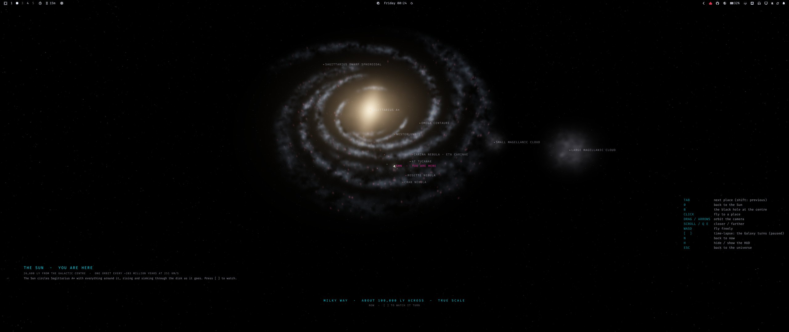
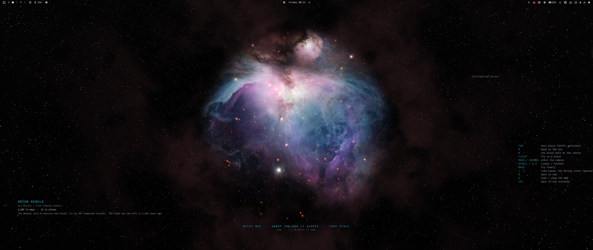

# Universe Background — an Omarchy shell plugin

A live, GPU-rendered wallpaper of the real universe for [Omarchy](https://omarchy.org).
The everyday view is a calm night sky on true black (OLED pixels stay off):
sharp stars, a soft layer of gas tinted by the theme accent, and the solar system in the lower left with the
planets where they really are today. The occasional shooting star or satellite
crosses the sky. Everything is procedural GLSL driven by a time uniform at your
display's native refresh rate, at native resolution (or a share of it the GPU
can carry, see [Adaptive quality](#adaptive-quality)), with no video decoding and
no loop seam.

From that view you can go further: into the solar system (live JPL orbits, a
real Earth and Moon, true-scale distances, a chase camera, the Sun's path
through the Galaxy), out to a true-scale Milky Way with 26 real places to fly to
(16 shown with real photographs) and the Local Group around it (Andromeda and
Triangulum from their own photos, the Magellanic Clouds as volumes, 72 dwarf
galaxies), down to the event horizon of Sagittarius A* through geodesic ray
tracing, or into the real sky around Earth.


## Screenshots

| | |
|---|---|
|  |  |
| The Milky Way view: measured arms, bar and bulge, with the real places you can fly to | Earth pinned in the system view: NASA Blue/Black Marble, turned to the current sidereal time, the Moon at its real distance |
|  |  |
| The Orion Nebula: a real ESO photo shown at its true angular size, north up, from Earth's side | Sagittarius A* at 20 Schwarzschild radii: the shadow, the photon ring, the lensed sky and the Doppler-beamed flow |
|  |  |
| Sky mode, view 1: the Galactic Centre in NASA's Deep Star Maps 2020 (Gaia DR2) | The Milky Way overview with the Magellanic Clouds at their real distances |

## How it works

- Any background whose filename ends in **`-live.webp`** is rendered by the
  shader instead of being shown as a static image (the file itself serves as
  the static fallback and picker preview).
- Regular images (jpg/png/webp/gif) render exactly as before; animated GIFs
  and WebPs also animate.
- Based on Omarchy's stock `background` plugin, so double-click launcher,
  theme transitions and the reveal animation behave normally.
- The sky is brighter on an empty workspace and deep black behind windows. The
  animation pauses while a fullscreen window (a game, a video) is visible, so
  the GPU goes to that window.
- The solar system has one camera (`lib/camera.js`): the overview, a pinned
  body, the chase and galactic views and the small system in the universe view
  are the same orbit camera, moved by one critically damped spring per channel
  and by van Wijk & Nuij flights. The shader, picks, labels and markers all
  share its projection, so what you click is where it is drawn.

## Install

Whole setup (this plugin + the matching theme + hook):

```bash
curl -sL https://gist.githubusercontent.com/vinceferro/14ca89b1f493986cff81a81721ac8670/raw/install.sh | bash
```

Plugin only:

```bash
omarchy plugin add https://github.com/vinceferro/omarchy-universe-background.git --enable
omarchy plugin disable omarchy.background   # the stock background, replaced by this
omarchy restart shell
```

Updates: `omarchy plugin update universe.background`.

Then set any `-live.webp` background (double-click the wallpaper to open the
picker). Pairs well with the
[ai-engineer theme](https://github.com/vinceferro/omarchy-ai-engineer-theme),
which ships one. The one-liner above also disables the stock
`omarchy.background` plugin, since this one takes over its job.

## The views

The explore views open only on an empty workspace, because they take the
keyboard while they are on. Esc leaves a view; so does opening a window or a
fullscreen app. `T` sets how much text is on the scene and `H` switches the
cockpit in every view (see [Text](#text)); at the full level the keys of the
current view are listed at the bottom left.

### Text

One setting, the text level, decides every word and line drawn over the
scene. `T` cycles it while exploring (`Shift+T` goes back):

| Level | Shows |
|---|---|
| `off` | the scene, nothing else |
| `names` | what you are looking at: place and planet names, markers, the chosen place's name and facts, a caption's title |
| `full` | names, plus the guide (the place's blurb, caption detail, the key hints) and the cockpit (the HUD: its rings, clock, words and beacons, see [The HUD](#the-hud)) |

`H` (and Super+Alt+J, which also works in the universe view) switches the
cockpit: between `full` and the last level below it. The level is remembered
across restarts. Changing it names the new level in the story band.

Three rules hold for every word on the screen, each written once
(`lib/text.js`, `scrim.frag`):

- **Reading time.** How long a text needs is its own word count: 1.5 s to
  find it and 0.3 s a word at a calm pace, never under 3 s, at most 40 s
  (`read`). Nothing is timed by hand.
- **One story band.** A sentence is said in one place, the lower third,
  whoever says it: the fall's events, the way home, the level's name after a
  change, a tour's or a film's caption (IPC `caption`). One caption at a
  time: it comes up in 0.8 s, stands for at least its reading time and goes;
  what is said meanwhile waits its turn (a speaker's newer caption takes its
  older waiting one's place). A script's caption stays until the script says
  something else, every other one leaves once read. It shows at every level,
  `off` included; in film mode only the script speaks.
- **Legibility.** Every text has a soft black backing behind it, feathered
  to nothing at its edge, exactly as strong as the picture under it is
  bright: the screen's own picture (the full pass, without the words) is
  kept at 96 texels across and the backing reads the brightness under the
  block from it. Over a dark sky it
  is not there at all; over the fall's closing light, the glowing gas or a
  bright photograph it keeps the words readable. It is black, so it only
  ever lowers what the OLED shows, and it has the text's opacity: it comes
  and goes with the words.

Text comes up with any interaction (a key, the pointer, the wheel, a flight)
and fades once it has had time to be read: a 5 s glance at the scene plus
its reading time. So a name goes after 8 s, a place's card after about
25, the key list after about 30, and a view left parked puts no standing text
on the OLED; any key brings it back (for a screenshot outside film mode,
press one first). A fall into the black hole holds its own text up until it
ends. The one standing exception is the cockpit's rings, clock and date,
which stay while the level is `full`: they are dim and drift. Every other
word on the HUD comes and goes like the rest.

Where text goes is computed from the screen (`lib/layout.js`). Nothing leaves
the safe rect: the screen less the bar (Hyprland's reserved bands), a camera
notch (the platform's `display-cutouts.json`, across the whole width, bar or
no bar) and a margin. Inside it the chosen place's card stands on the key
hints in one column at the bottom left, the mode caption (one for every
view: a title and a line or two of detail) stands at the bottom
centre, and the HUD is one disc, sized and placed by the aspect: right of
centre on a wide screen (as far right as a beacon's name beside its rim
allows), smaller and in the top right corner on a narrow one. It owns a
radius, never a rect, so nothing reflows at any aspect and the scene keeps
the rest of the screen. Scene names go to the right of
their thing, else to the left, else their words hide (the dot stays): clear
of the bar and notch, the card, the caption, the HUD and each other (by
their measured widths in the shell font, not an estimate). The
chosen or hovered thing always shows its name, and the HUD dims while that
thing is inside its ring.

### The HUD

One radial instrument: no column of readouts beside it, so the universe keeps
the stage. Its rings are ordered by meaning from the centre out, and that
order is the same in every view:

| Zone | What | Reads |
|---|---|---|
| time | the hub | the clock and the date; one readout line under them (the needle's exact figure) while you are doing something |
| time | seconds ring | a short arc gliding round once a minute |
| time | day ring | 24 hours, noon at the top: the dim thick arc is daylight at home (`homeLat`, `homeLon`), the bright caret is now |
| machine | CPU arc, GPU arc | load along a 270-degree sweep, with a notch on each arc's outer edge for its temperature (30 to 100 C along the same sweep, a dim mark at 90) |
| machine | memory dots | used of total |
| flight | range scale | how far the named things are, on a log scale: one triangle (a bug) per beacon, in the beacon's colour. Off the scale it is hollow, pinned at that end |
| flight | primary dial | the one quantity the view controls, as a needle; it rests dim on a stop pin at 7:30 when there is nothing to show |
| flight | gap window (6 o'clock) | one signed quantity as a diamond on a dotted scale, or the Moon as it is lit now |
| world | beacons on the rim | which way the named things lie, on or off screen (hollow: behind you) |

The beacon and the bug are a pair: the beacon says which way, the bug of the
same colour how far. Only the flight zone changes with the view:

| View | Dial | Range scale | Gap window |
|---|---|---|---|
| Universe | a bare track | none | the Moon |
| Flight | throttle, 0 to 100% (the star layers have no physical unit, so never a speed) | none | none |
| Solar system | the time rate on seven detents, `LIVE` to a year a second | AU, 0.001 to 100: the Sun, Earth, the Moon, the chase target, from the pinned body | the Moon, beside Earth or the Moon |
| Milky Way | speed as a multiple of light, 10^5 to 10^13 (long ticks at a million, a billion, a trillion) | light years, 1 to 10^7: the Sun, the centre, the target (or Andromeda), the nearest place | height over the disk plane: a dot a decade (10, 100, 1000 ly), hollow beyond a kiloparsec |
| Sky | the field of view as an arc of its true angle | galactic longitude on a tape (growing leftward, as on the sky), the heading under the mark at the top, zero in magenta | galactic latitude, a dot every 30 degrees |
| Falling into Sgr A* | the radius in Schwarzschild radii on one signed-log scale from the start to the end, a hairline at the photon orbit, magenta redlines at the two horizons | none | none |

Two views borrow the day ring: while the system view time-lapses it is a
year ring (twelve month ticks, the caret at the simulated day of the year),
and during a fall it drains with the time left on our own clock while the hub counts
that time down (the wall clock is in the bar). In mathematics mode the dial's
rim is dashed beyond the inner horizon and r = 0 has a mark: the scale goes
on, the physics does not.

A scale with no honest value is a bare track: a parked view has no needle, a
free camera has no distances, a machine without `nvidia-smi` has no GPU
figure. The fall has no speed scale, because the speed `lib/fall.js` knows
is dr/dtau, which nobody measures locally (it passes c inside the horizon).

At rest the only words are the clock and the date. The rest (the readout
line, `CPU` / `GPU` / `MEM` and the unit words in the gap, the labels of the
dial's long ticks just outside the rim on a wide screen, the beacons' names)
come up with any interaction, when the pointer rests inside the disc, or
for a few seconds at an event (another place is now the nearest, the disk
plane crossed, a horizon crossed, a flight arrived; the machine labels alone
when the CPU stays over 85%, the GPU passes 80 C or memory 90%), then fade.
The facts that describe a body (distances, light time, orbit, day) are on
the pinned body's card at the bottom left.

For the OLED: everything is at the cockpit's low brightness, the disc drifts
and leans toward the pointer, the whole frame rocks 4 degrees either way on
a 13-minute sine (scale and pointer turn together, so readings do not
change), static parts are hairlines, and the bright parts are the ones that
move with data or time. A small disc drops detail rather than crowd it:
minor ticks that would sit under 4 px apart, watts and gigabytes, the
landmark labels; under scale 0.65 the temperature notches and all but the
six-hour ticks.

### Anatomy

`C` shows what the body in front is made of: thin lines where its parts
are, each with a short name and a number. It works the same way in every
view and for every body, from one table and one set of rules
(`lib/anatomy.js`, `lib/anatomy-data.js`):

| View | Subject |
|---|---|
| Solar system | the pinned body (the Sun when none is pinned) |
| Milky Way | the chosen place; at the Sun's place or in free flight, the Galaxy itself |
| Sky mode | the Milky Way, seen from inside |

When none of the subject's parts suits the zoom, the record that holds it
takes over: beside the Sun you see the Sun's layers, from 100,000 light-years
the Galaxy's bar, the Sun's orbit and the Fermi bubbles, from further still
the Local Group. Flight has no body, so nothing is drawn there.

**How a line tells you what it is.** One legend for every body:

| Line | Meaning |
|---|---|
| solid | measured |
| dashed | a model |
| dotted | mathematics only: drawn in mathematics mode (`K`), never otherwise |

**The rules**, the same for every body:

- A part is drawn when it spans between 24 px and 1.5 screen heights. Zoom
  in or out and others take its place.
- A part closer than 3 px to its neighbour is not drawn: its name and number
  join the neighbour's label (Earth's crust beside the mantle).
- Where the view exaggerates sizes against distances (the system overview),
  only what is inside the body is drawn. Pin a planet, or use the chase
  view, and its surroundings appear at true scale.
- At most six labels show at once: the part being told, then the largest
  parts that find room.
- Lines and labels stay inside the safe rect and out of the rail, the
  caption, the HUD's disc and a story caption.

**It uses what the text already has** ([Text](#text)). The lines show at
every level, like the orbit lines; the names are `names`; the numbers are
`full`. At `full`, turning it on says the body's headline in the story band
and then tells the lines one by one, the largest first, each lit while its
fact is up. Any key ends that walk. Pointing at a line says its fact. Lines
and labels sit on the idle clock like every other text: they fade after
their reading time and any key or pointer movement brings them back, so a
parked view keeps nothing lit. A flight to a place, the fall and the way
home fade the lines; they return on arrival. The setting is remembered
across restarts.

**Sagittarius A\*.** The dark shape is the shadow, drawn where the render
itself puts its edge (`shadowOutline()` in `lib/kerr.js` uses the shader's
own test). Seen from the side it is a D, 4.77 Rs wide: the flat edge, 1.32 Rs
from the centre, is on the side the spin carries toward you, and the gas on
that same side is the bright one because it is coming toward you. The label
gives the factor for your viewpoint (about 8 times from the side), worked
out as the shader adds up the gas's light. A faint circle shows the 5.20 Rs
shadow the hole would have without spin, and a solid one the ring the Event
Horizon Telescope measured. Inside the shadow are the event horizon (0.67
Rs, about a third as wide as the shadow), the ergosphere, the photon shell
and the inner edge of the gas. Seen down the spin axis the shadow is round
and there is no brighter side. Every number is read from `lib/kerr.js` at
the live spin.

**Where the numbers come from.** `tools/anatomy-rows.json` holds every row as
it was fact-checked, and `docs/anatomy-sources.md` says how each number was
confirmed. `node tools/gen_anatomy.js` writes the table from them. A row
whose place could not be fixed from a checked number (an orbit whose
orientation is not sourced, a ring that must be fitted on a photo) keeps
its words in the table and is not drawn: ten of the 126 today.

**What this build cannot show yet.**

- The five single stars (Betelgeuse, Vega, Sirius, Alpha Centauri, Polaris)
  have rows, but the Milky Way view cannot come closer to a place than
  0.2 pc, far too far to see a star's surface. `anatomyDemo` shows them.
- The Sun's termination shock and heliopause need a view about 300 AU
  tall at true scale. The chase view from the Sun stops at 14 AU, so today
  it reaches the edge of the corona and no further.
- Points on the nebula photos (the Trapezium, the Crab's pulsar) are placed
  by their sky coordinates from SIMBAD. Whether each photo is centred
  exactly on its place has not been checked by eye.

### Universe (the default)

The pointer shifts each layer by its depth. Click or scroll up over the solar
system (lower left) to enter the system view; middle double-click to fly
through the stars; left double-click elsewhere opens Omarchy's background
picker and right double-click the theme switcher.

### Flight

Middle double-click the desktop, or `omarchy-shell background navigate`.

| Key | Action |
|---|---|
| `W` / `S` | thrust forward / back |
| `A` / `D` | strafe left / right |
| `R` / `F` | up / down |
| `Esc` | back to the universe |

### Solar system

Click or scroll up over the solar system, or `omarchy-shell background system`.
Positions come from the real date using JPL's approximate Keplerian elements
(Standish, valid 1800-2050), so the planets, Earth's rotation and the Moon are
where they are right now. The overview squeezes the orbits so they fit on
screen; pinning a planet or the Moon blends the whole system to true scale
during the flight to it: real orbit distances, real radii, the real Sun. A
pick is one continuous move that lands with the body centred at its final
size; any input mid-flight takes over from the current motion. Zooming out
past the overview's framing returns to the squeezed layout.

| Key | Action |
|---|---|
| click / `1`-`6` | pin a planet (Mercury to Saturn) |
| `M` | pin the Moon |
| `Tab` / `Shift+Tab` | next / previous body |
| `0` | the Sun |
| `V` | chase view behind the pinned body |
| `G` | galactic motion: the Sun's path through space |
| `X` | fly out to the Milky Way |
| `I` | show / hide orbit lines (off by default) |
| `T` / `Shift+T` | text level: off, names, full (see [Text](#text)) |
| scroll / `Q` `E` | zoom about the point under the pointer, or about the pinned body (zooming all the way out returns to the universe) |
| drag / arrows | orbit / tilt the camera about what it is looking at (half a screen height of drag is a right angle; a release coasts) |
| right-drag (or Shift-drag) / `W` `A` `S` `D` | pan: the ecliptic sticks to the pointer and coasts on release (this unpins the body) |
| `O` | auto orbit |
| `[` `]` | slower / faster time (live, 1 min/s, 1 hour/s ... 1 year/s) |
| `N` | back to now |
| `Esc` | back to the universe |

**Chase view** (`V` with a body pinned): two-point framing. The same camera
dolly-zooms to a 53-degree field (the pinned body keeps its size) and sits
behind a foreground body A, looking along the line to a target B, with A
centred and B in frame. B is the Sun by default; click another body or press
`E` to look along the line to it, `R` to stand behind the other one. The
camera's yaw rides the A-B direction, so the pair stays framed as they orbit.
Bodies are at their real sizes and distances.

| Key | Action |
|---|---|
| `X` | lock the eye exactly on the A-B line / angled over-the-shoulder view |
| `E` / click | look toward another body (the next one, or the one clicked) |
| `R` | swap A and B: stand behind the target, looking back |
| drag / arrows | swing the camera |
| scroll / `Q` | closer / farther along the vector |
| `Tab` / `0`-`6` / `M` | chase another body (`0`: the Sun) |
| `[` `]`, `N` | time rate, back to now |
| `V` / `Esc` | back to the system view (the overview's angle is restored) |

**Galactic motion** (`G`): the solar system drawn in the Galaxy's rest frame.
The Sun travels at 247 km/s toward Cygnus and each planet leaves the trail of
where it has really been: stretched helices around the Sun's straight path,
with the orbital plane tilted 61 degrees to the direction of travel.

| Key | Action |
|---|---|
| `-` `=` | slow the Sun down (1/2 ... 1/200) so the coils show; the caption says by how much |
| `I` | show / hide the 2-year trails |
| `V` | look back from just ahead of the Sun along its path (again: the side view) |
| drag / arrows | swing / tilt the camera |
| scroll / `Q` `E` | camera distance |
| `[` `]`, `N` | time rate, back to now |
| `G` / `Esc` | back to the system view |

### Milky Way

`X` from the system view, or `omarchy-shell background milkyway`. A volumetric
model of our Galaxy at true scale, in kiloparsecs: the spiral arms measured
by Reid et al. 2019, the long bar at 27 degrees to the Sun-Centre line, the
boxy bulge, the dust lanes, and the Local Group around it at real distances,
sizes and tilts: Andromeda and Triangulum as thin disks unfolded from their
own photos (Andromeda with its 10 kpc ring of young stars and its ellipticals
M32 and NGC 205 beside it), the Large Magellanic Cloud as a barred, lopsided
disk, the Small one as an irregular body stretched along our line of sight,
and 72 dwarf galaxies from McConnachie 2012 as faint glows, each as bright as
its magnitude says. Exposure adapts like an eye: dimmer inside the disk and
much dimmer in the crowded bulge.

A galaxy with a photo hands over by view angle: within 14 degrees of Earth's
line of sight you see the photo, past 32 degrees the 3D model, a cross-fade
between (the model is unfolded from the same photo, so they match where they
meet). The dwarfs are places too: hover to find one (its marker and name
appear under the pointer, or once it is big on screen), click to fly there.
`V` stands you at Andromeda's edge (35 kpc out, on our side, so its own light
is behind you) looking back at the Milky Way, a spindle 2.7 degrees long, 21
degrees from edge-on, seen from the south.

26 real places are marked, with distances checked against Gaia and VLBI
catalogues: nebulae (Orion, Carina, Eagle, Lagoon, Rosette, Crab, Ring,
Helix, Gum, Cygnus X), clusters (Pleiades, Hyades, Westerlund 1, Omega
Centauri, 47 Tucanae), stars (Betelgeuse, Alpha Centauri, Sirius, Vega,
Polaris), the Magellanic Clouds, the Sagittarius Dwarf, Andromeda, Triangulum
and Sagittarius A*. Sixteen of them have a real photograph (see
[textures/CREDITS.md](textures/CREDITS.md)): fly there and you approach from
Earth's side, the way the photo was taken, and the image is shown at its true
angular size, north up. Near the Sun the model blends into the real sky.

| Key | Action |
|---|---|
| `Tab` / `Shift+Tab` | next / previous place |
| click | fly to the place under the pointer |
| `0` | home: the Sun in the middle of its Galaxy, the view this one opens on (the same flight every return takes, see [The way home](#the-way-home)) |
| `B` | the black hole at the centre; `B` again goes down to 6 Schwarzschild radii on its spin axis, and parked there `B` (or one more scroll in) lets go and falls in |
| `K` | mathematics mode on / off: the fall follows Kerr's equations on through the ring into the other universe (beyond tested physics; takes effect at the next fall) |
| `V` | the Milky Way from Andromeda (scroll in to cross the gap along that line) |
| `T` / `Shift+T` | text level: off, names, full (see [Text](#text)) |
| drag / arrows | orbit the camera (falling into the hole: look around) |
| scroll / `Q` `E` | closer / farther |
| `W` `A` `S` `D` | fly freely, level with the disk |
| `[` `]` | time-lapse: the Galaxy turns (100,000 years/s up to 20 million years/s) |
| `N` | back to now |
| `Esc` | back to the universe |

The time-lapse turns the disk around the Galactic Centre at the Sun's angular
speed, one lap in about 203 million years, with the Sun bobbing through the
plane. It is simplified: the whole disk turns together, whereas real disks
shear, and the caption says so.

#### The way home

Home is one pose: the Sun in the middle of the screen with its Galaxy around
it, marked SUN · YOU ARE HERE, its card in the rail. The view opens on it,
and every return lands on it by the same flight (`gxHome` in
`Background.qml`, scripted by `lib/camera.js`): `0`, a click on the Sun,
`fly sun`, Esc during a fall and the end of both falls.

Travel in this view is one law (`lib/camera.js` `Voyage`): the focus glides
to the chosen place on a critically damped spring and the camera's distance
is drawn to the larger of what was asked for and twice the trip still to
go, so a long trip rises above the disk, keeps where it is going in frame
and comes down as it arrives. Every trip starts from rest, none has a jerk,
a new destination on the way carries the velocity on, and a place that
itself moves (the time-lapse) is followed without lag.

From a view that can be flown out of, the way home is that flight, flown
slower than a hop (95% of it in 5 s). From inside the hole there is no road
out, so the screen goes black first (one second of it, at a fall's end and
after Esc alike), the view opens over the Galactic Centre, 1.2 kpc out and
low over the disk, and once the picture is half back the same flight leaves
from there: out along the disk to the Sun's place, the camera pulling back
from 1.2 to 34 kpc and rising, the Centre on screen from the first frame to
the last and the Sun's place in frame within two seconds. Seven seconds
later it has landed: the Sun's marker and card come up, and after a fall the
story band says "Back home: the Sun, one star in the Orion Arm, 26,600
light-years from the black hole we just left". After a realistic fall the
key hints then open with the invitation to the other ending (`K`, then `B`).
The whole timeline is checked in `tests/test_camera.js` (continuity, what is
in frame, the same at 60 and 165 Hz) and run for real by the headless fall.

### Sagittarius A*

`B` in the Milky Way view (scrolling in goes down to 6 Schwarzschild radii).
Every pixel's light ray is traced backward through the curved spacetime of a
spinning (Kerr) black hole of about 4 million solar masses (4.15 million in
every figure the fall computes: GRAVITY 2019), in Kerr-Schild
coordinates (`hole.frag`; the same march in JS with its tests in
`lib/kerr.js`): the shadow, the photon ring, the stars and the Galaxy's glow
lensed around it, the twist that frame dragging gives the lensed sky, and the
flattening of the shadow's one side at high spin, all from the tracing,
nothing painted. The spin is a/M = 0.94, one of the models the Event Horizon
Telescope's 2022 papers favour for Sgr A* (a magnetically arrested flow seen 30 degrees from
its axis; Daly et al. 2024 find about 0.9 another way, Fragione & Loeb 2020
argue for under 0.1 from the S stars' orbits): it is not measured, one number
in `Background.qml` (`holeSpin`) changes it, and 0 gives the Schwarzschild
hole this replaced. Its horizons are at 0.67 and 0.33 Rs; the shadow's edge
is found in closed form at full resolution from the ray's constants of
motion (the critical points of the Kerr radial potential), so it stays
crisp. The gas is a thick, hot torus on prograde Kerr circular orbits
(Bardeen, Press & Teukolsky 1972) down to the innermost stable orbit at
1.01 Rs, each sample's shift the one dot product of the ray's and the gas's
4-velocities: Doppler beaming on the approaching side, gravitational
redshift deep in the well, frame dragging. The spin axis is about 30 degrees
off the line of sight from the Sun's side, as the EHT image and GRAVITY's
flare loops suggest, so the D-shaped flattening is subtle from there; orbit
the camera round to the equator to see it in full.

The colours are a false-colour impression. The real flow around Sgr A* emits
mostly in radio and infrared and is far too faint to see by eye; visible
light does not reach us through the dust at all. The gas motion is also
sped up 30 times, so an orbit at the innermost stable radius takes about 17
seconds on screen rather than its real 8.2 minutes (at a/M = 0.94; half an
hour is the figure for a hole without spin). Where both sides of the torus lie on one
ray (the photon ring) the hue is the mean shift's, not the mix.

**The fall.** `B` flies to the hole and `B` again down to 6 Rs on the spin
axis (the descent steers to the pole on the camera's side); parked there,
`B` lets go (so does one more scroll in, and so does free flight that
carries the camera below the horizon: there is no flying through; if the
camera was dragged off the pole it glides there first). The camera is then
in free fall down the axis from rest at 6 Rs (`lib/fall.js`): the way down
to the outer horizon, 16 minutes on our own clock, is shown in 24 s (about
40 times faster on average; the hub shows the rate live), and the inside at
the true rate,
14.9 s of proper time between the two horizons (28.7 s to the singularity
for a non-spinning hole, which `holeSpin = 0` still gives). The ray tracer
takes the falling observer's frame: aberration keeps the shadow ahead and
smaller than a hovering observer would see it. It is a disc 44 degrees
across at 6 Rs, 80 at the outer horizon and 60 again at the inner one: for
someone falling in it never fills half the sky. The sky beside it is
squeezed toward its rim and shifted blue (4.5 times the frequency at the
rim when crossing), unchanged in frequency exactly sideways, and red and
dim straight behind (0.55 at the horizon). The outer horizon is crossed as
smoothly as open space (a hole this large is gentle at its edge): the HUD
and the story band are what say so.

**Where the camera looks.** Nothing steers on the way down, but a fixed view
shows little of this, so the view is scripted (`look()` in `lib/fall.js`),
as a tilt from straight down the axis and a pan about it, eased between
keys in screen time: down at the hole for 4 s; the hole lowered in the
frame by 8 s; from 11.5 to 19.5 s (about 4.2 to 1.4 Rs) a glance back up at
the sky being left, 145 degrees from straight down, held from 13.5 to 16 s;
then down to the shadow's rim, held in the lower part of the screen through
the horizon crossing at 24 s (the rim's own angle, from the same closed
form the shaders draw the edge with); between the horizons a slow look
around, up to level and 50 degrees to one side, then 35 to the other; level
for the realistic ending, whose light closes in from above; in mathematics
mode down through the ring and, on the far sheet, back at it. Drag or the
arrows look around on top of that (right looks right, up looks up; all the
way round, short of straight up or down). Only the camera turns; the fall
stays on the axis, and the ray tracer's frame with it. After 2.5 s without
input the view eases back to the scripted one.

**Exposure.** Light from ahead is boosted (the gas by g^3.5: 47 times at a
shift of 3), light from behind dimmed, so one exposure is white ahead or
black behind. The hole's picture has its own exposure while falling
(`exposure()` in `lib/fall.js`): the mean boost over fifteen directions of
the current view against the same at the start, to the power 0.8 (partial,
as eyes adapt), between 0.004 and 6, eased at 6 e-folds a second closing and 2.5 opening; what is
still brighter than 0.6 rolls off toward 1 with its colour kept instead of
clipping (`universe.frag`, `HOLE_KNEE`). Drawn off screen along both
scripted falls (`tools/hole_view.py`), no frame is more than 7% white
before the realistic ending's own light.

The fall ends at the inner (Cauchy) horizon, because the physics does: the
Kerr solution continues through it, but a real hole's inner horizon is
unstable (Penrose 1968; Poisson & Israel 1990, "mass inflation"; Ori 1991):
light falling in after us arrives there blueshifted without bound: it is the
edge of what the equations can predict. The ending is told
rather than cut. The observer would reach the inner horizon at full speed,
and a camera doing that simply stops: so the last 2.5 s of proper time are
shown over 6 s, the fall slowing into r- (the HUD says "slowed to watch"; it is
a way of showing it, not time dilation). Over the last 5 of those seconds
the light closes in: the glow below turns blue, what is still seen brightens,
and a blue-white front spreads from the pole we fell from, where the light
falling in after us comes from, over the whole sky (a labelled cartoon of
the unbounded blueshift, in `universe.frag`; the front veils what is under
it instead of brightening it, so the sky squeezed into arcs does not show
through as bands). Only then the screen fades to
black, holds a second, and the way home begins (below): 18.4 s from
the outer horizon to the fade. Esc ends the fall by the same road (the one
function, `gxHome`); nothing leaves the camera inside the hole, and while it
falls the keys that steer or change the view do nothing.

**Why two falls.** It is one fall with two endings. The realistic one stops
at the inner horizon because that is the last place the equations can be
trusted: in a real hole the light falling in piles up there without limit.
Mathematics mode (`K`) follows the idealised Kerr solution past it, through
the ring into the space beyond, which takes a push no fall from rest can
have. Both say the same things on the way down to the inner horizon.

The fall says where it is in the story band, at every text level, `off`
included. `lib/fall.js` only names the events and when they happen
(`story`, `CAPTIONS`): the glance back at 11 s ("Looking back: the sky we
came from, reddening and dimming as we pick up speed"), the event horizon at
the crossing ("Crossed, as smoothly as open space. From here every path
leads inward, even light's"), the inner horizon 6 s before its light begins
to close in ("Light that fell in after us piles up here, blue and blinding.
This is the edge of what physics can predict"); in mathematics mode the
inner horizon as an invitation ("Here we leave tested physics and follow
Kerr's equations onward, as pure mathematics"), "Through the ring" 5.5 s
before the disk and "The other universe" beyond it. The band gives each its
reading time (6 to 11 s) and keeps them in order; none is cut, and
`tests/test_fall.js` plays both falls through the band to check that every
caption is fully up for its reading time and that the inner horizon's is up
almost 5 s before the light begins. In film mode the fall says nothing: the
script has the words. There is no "Between the horizons" caption any more:
the inside is shown at the true rate, and neither fall has room for one
(9 s between the horizons in the plunge).

The HUD's hub counts the time left on our own clock, its dial shows the
radius against the horizons, and the caption's detail line says where we are
and names the landmark ahead (the event horizon, the inner horizon, in
mathematics mode the middle of the ring and the journey's end): how far
below it is in kilometres and how long until it on our own clock. The card
defines the unit once (one radius = 12.3 million km) and takes its figures
from the running fall (`lib/fall.js`): how much faster the approach is
shown, the seconds between the horizons, the plunge's speed. `status` reports phase and radius; the maths has its own checks
in `tests/test_fall.js` and `tests/test_kerr.js`, and the whole fall is run
headless by `tests/harness/fall.sh`.

**Mathematics mode** (`K`, or `mathMode true` over IPC; off by default, not
remembered, takes effect at the next fall). What the maximally extended Kerr
solution says, followed past where physics stops: through the inner horizon,
through the disk inside the ring singularity (on the axis the ring is never
touched; r passes through 0 to r < 0) into the negative-r sheet, an
asymptotically flat universe where the hole's gravity repels. The view there
is traced like everything else, in the r < 0 sheet: our own sky through the
throat inside the ring, and around it the other universe's sky, which the
solution gives a space of its own but no stars, so they are plainly invented
(sparse, cold violet-white and amber, no Milky Way). Looking through the
ring's open middle from our side, those stars are what shows in the dark
disc. Rays that pass close to the ring end on either sheet from one texel
of the tracer's layer to the next; a lone texel that disagrees with its
three neighbours, in kind or in gas light, is left out when the layer is
read (`universe.frag` `holeRead`), so the passage has no specks. The camera is pushed away
(the repulsion is gentle: 444 s of proper time to -10 Rs, shown in 20 s), and
then the usual fade and the way home. One honesty the maths forces: an
observer from rest at 6 Rs can never get there. The potential peaks at
r = -a with 1 + M/a > E^2, so a from-rest fall turns back inside the inner
horizon at r = a^2/r0 = 0.037 Rs and is thrown out into a new positive-r
universe instead; reaching r < 0 needs E >= sqrt(1 + M/a) = 1.44, and the
mode starts with E = 1.5, an impossible shove down the axis (0.75 c at
infinity; 0.79 c to someone hovering at the start, which is the figure the
card gives). The
caption, the card and `status` all say so. The trajectory has that energy from
the first frame; the frame the picture is drawn in comes on over the first
3 s (`viewE`: from rest to E = 1.5), the shove shown as an acceleration
rather than as one frame in which the shadow shrinks to a third and the sky
ahead turns blue-white.

**What you see below you.** The dark toward the centre, the shadow from
outside and the disc ahead once inside, is not quite black:
it holds the faint light of gas that fell in ahead of us. Outside the horizon
that light climbs up to us from below. Inside, where nothing climbs, it is
light the gas sent while it was still above where we are now, and we catch it
because we fall faster than the light does. For every ray the frequency ratio
comes from the two 4-velocities along it, the gas's and ours, and is drawn
with the same colour shift as the sky: the gas just ahead of us is barely
shifted, gas near the horizon fades to a black red, and deep inside, along
the edge of the dark cap, it turns blue (`hole.frag`, `infallGlow`). The
simplifications: the gas is a steady, spherical, optically thin inflow from
rest far away (Sgr A* really swallows a thin, clumpy, slowly rotating
trickle), its emissivity falls as r^-3 (density squared, for a constant mass
flux) and ends at the drawn flow's inner edge, rays that reach the sky do not
collect it, a hint of clumpiness is painted by direction rather than traced,
and near the singularity, where the model would blaze, its brightness is
softly clipped. It stays faint: at rest at 6 Rs the shadow is still dark to
the eye, and the glow grows as the fall goes on. Its numbers are checked in
`tests/test_fall.js` too.

### Sky mode

`omarchy-shell background sky` (or `skyView <1-7>`). The real sky around
Earth from NASA SVS Deep Star Maps 2020 (Hipparcos-2, Tycho-2 and Gaia DR2)
in galactic coordinates, a true camera projection you can look around in.
Seven named views match the static 5K wallpapers made by
`tools/make_sky_views.py`; when the camera sits exactly on one and that
render exists in `~/.local/share/universe-background/sky/`, it fades in at
native resolution.

| View | Centre (l, b) |
|---|---|
| 1 Milky Way core | 0.0, -1.5 |
| 2 Cygnus Rift | 78.0, 1.0 |
| 3 Aquila, Scutum | 28.0, -1.5 |
| 4 Carina, Southern Cross | 295.0, -1.0 |
| 5 Magellanic Clouds | 291.0, -38.0 |
| 6 Centaurus, Norma | 320.0, -0.5 |
| 7 Scorpius, Ophiuchus | 353.0, 16.0 |

| Key | Action |
|---|---|
| `1`-`7` / `Tab` / `Shift+Tab` | the named views |
| drag / arrows (or `W` `A` `S` `D`) | look around |
| scroll / `Q` `E` | zoom (8 to 130 degrees) |
| `Esc` | back to the universe |

### Suggested shortcuts

Bindings live in your Hyprland config, not in the plugin. The views only open
on an empty workspace, so a small helper that first jumps to one is handy;
save this as `~/.local/bin/universe-explore`:

```bash
#!/bin/bash
# Open a view of the live wallpaper, jumping to an empty workspace first.
ws=$(hyprctl activeworkspace -j)
if (( $(jq .windows <<<"$ws") > 0 )); then
  used=$(hyprctl workspaces -j | jq -c '[.[] | select(.windows > 0) | .id]')
  target=""
  for id in {1..10}; do
    if jq -e "index($id) == null" <<<"$used" >/dev/null; then
      target=$id
      break
    fi
  done
  [[ -z $target ]] && exit 0
  hyprctl eval "hl.dispatch(hl.dsp.focus({workspace=$target}))" >/dev/null
  sleep 0.4
fi
omarchy-shell background "${1:-system}"
```

Then in `~/.config/hypr/bindings.conf`:

```ini
bindd = SUPER ALT, U, Solar system, exec, universe-explore system
bindd = SUPER ALT, Y, Milky Way, exec, universe-explore milkyway
bindd = SUPER ALT, K, Real sky, exec, universe-explore sky
bindd = SUPER ALT, J, Wallpaper HUD, exec, omarchy-shell background toggleHud
```

## IPC

Everything is reachable through the shell's IPC, `omarchy-shell background <function> [args]`:

| Function | Effect |
|---|---|
| `universe` | back to the default view |
| `navigate` | toggle flight |
| `system` | toggle the solar system view |
| `focus <0-7>` | pin a body: 0 the Sun, 1-6 Mercury to Saturn, 7 the Moon (opens the system view if needed) |
| `chase` | toggle the chase view behind the pinned body |
| `align <true/false>` | chase camera exactly on the A-B line, or angled |
| `look <body>` | what the chase camera looks toward (B): a name (`sun`, `earth`, `moon`, `mars` ...) or 0-7 |
| `galactic` | the galactic-motion view (opens the system view if needed) |
| `milkyway` | the Milky Way view |
| `fly <place>` | fly to a place by name prefix (`"Orion"`, `"Sagittarius A"`, `"Andromeda"`; `sun` for the Sun), or to a named viewpoint (`"Milky Way from Andromeda"`) |
| `hole` | the same step as `B`: to Sgr A*, down to 6 Rs, let go |
| `fallLook <yaw> <pitch>` | falling into the hole: look this many degrees right and up from the scripted view, held until the next drag or arrow (for tests and filming) |
| `mathMode <true/false>` | mathematics mode: the fall follows the extended Kerr solution through the inner horizon and the ring into the other universe (not physics); takes effect at the next fall |
| `anatomy <on/off/toggle>` | the anatomy layer, the `C` key (see [Anatomy](#anatomy)); remembered across restarts |
| `anatomyDemo <body> <span>` | any body's anatomy without flying there, for checks: a record's id (`sgrA`, `sun`, `earth`, `saturn`, `orion`, `milkyWay` ...; `anatomyReport` lists them) in a frame of its own, the body in the middle of the screen seen from 20 degrees above its equator, `span` of its units to the screen's height (0: twelve of its radii). No captions; `anatomyDemo "" 0` ends it |
| `anatomyReport` | prints, as JSON: the setting, the subject, the record drawn and every row of it (tag, size, strokes, label and where it stands, in the first screen's pixels), what the drawing measured (the shadow's width, the bright side's factor), how many passes were worked out and their milliseconds, and the table's ids |
| `sky` | Sky mode, at the last view |
| `skyView <1-7>` | Sky mode at a named view |
| `text <level>` | the text level: `off`, `names` or `full`; `next` and `prev` cycle it (the `T` key); `toggle` is `toggleHud`. Remembered across restarts (see [Text](#text)) |
| `toggleHud` | the cockpit key: between `full` and the last level below it |
| `textHold <level>` | a level for now (a film, a tour), shown instead of the saved one and never saved; `textHold ""` lets go of it, and so does any `T` or `H` |
| `hud <0..1>` | cockpit brightness until the shell restarts (default 0.38) |
| `film <true/false>` | film mode for recording: the level `off` for as long as it is on, reached over 1.5 s, so only the story band shows, and only the script speaks in it; the saved level is untouched (film itself is not remembered) |
| `caption <title> <body>` | a script's caption in the story band (see [Text](#text)): it comes up in 0.8 s once the caption before it has had its reading time (1.5 s + 0.3 s a word) and stays until the next `caption`; `caption "" ""` ends it. It shows at every level; outside film mode the cockpit, the key column or the mode caption steps aside while it touches them |
| `tourKeys <rows>` | a tour's own keys in the bottom-left column, in place of the view's hints and the place card: `"SPACE=next; B=back; ESC=leave"`; `tourKeys ""` ends it. They show at `names` and `full`, not at `off` or in film mode |
| `textReport` | prints, as JSON: the level, a hold, what is showing right now, and every screen's zones in logical pixels (safe rect, rail, caption slot, story band, the HUD's centre, scale, radius and reach) |
| `textDebug <true/false>` | outlines those zones over the scene, with a circle that must lie on the HUD's rim |
| `hudDemo <view>` | the HUD's instrument with fixed, invented values, to look at every element without flying there: `universe`, `flight`, `system`, `year`, `galaxy`, `outside`, `sky`, `fall`, `math`; `hudDemo off` returns to the live values. The hub's date line says `DEMO` while it is on |
| `status` | prints `<view> <fall phase or -> <radius in Rs, signed> <real/math>`, e.g. `galaxy outer-horizon 0.52 real`, for scripts; the phases are `falling`, `outer-horizon`, `inner-horizon`, `ring`, `other-universe`, `out`, `in` |
| `quality <level>` | render quality: `auto` (default), `full`, `high`, `balanced`, `low`, or a render scale from 0.25 to 1; remembered across restarts (see [Adaptive quality](#adaptive-quality)) |
| `qualityInfo` | prints what each screen runs at, and the hole tracer's layer, e.g. `DP-1 165 Hz: auto (nvidia): scale 1.00, 5120x2160 direct, idle 60 fps \| hole 2560x1080 32F, 33/21 Hz, est. 9.1 ms a draw` |
| `holeScale <scale>` | the hole tracer's layer as a fraction of the screen (0.25 to 1; 0: the automatic choice), to compare on screen with `perf true`; not remembered |
| `perf <true/false>` | frame meter: every 5 s each screen logs its frame rate and the average and longest interval between frames to the shell's log (not remembered) |
| `refresh`, `set <path>`, `setInstant <path>`, `transition <from> <to>`, `themeTransition ...` | the stock background plugin's functions, unchanged |

## Real data and accuracy

What is real:

- **Planets**: positions from JPL's approximate Keplerian elements at J2000
  with their rates per century, solved for the real date (also when the
  system view steps time forward). Rotation periods and radii are real.
- **Earth**: NASA Blue Marble (day) and Black Marble (night), turned to the
  current Greenwich sidereal angle with the axial tilt, and a marker at the
  author's home. **Moon**: the LRO map, placed by a low-precision geocentric
  ephemeris, 27% of Earth's radius at about 60 Earth radii once at true scale.
- **The Sun's motion**: 247 km/s toward Cygnus (30.32 km/s/kpc at 8.15 kpc: Reid & Brunthaler 2020,
  Schoenrich et al. 2010; one lap in 203 million years), with the orbital planes' tilts and nodes from JPL.
- **Milky Way**: arm geometry from Reid et al. 2019, bar and bulge from Wegg
  et al. 2013/2015 and Bland-Hawthorn & Gerhard 2016, dust from Drimmel &
  Spergel 2001, measured scale heights, R0 = 8.15 kpc. Place positions from a
  catalogue checked against Gaia and VLBI distances; the HUD gives distance,
  size and light travel time.
- **Local Group**: Andromeda (761 kpc, inclination 77, PA 38) and Triangulum
  (840 kpc, inclination 55.08, PA 201.12: Koch et al. 2018) are their real
  photos unfolded face-on; Andromeda's ring at 10 kpc (Gordon et al. 2006)
  gets a young-star tint and height; M32 and NGC 205 sit at their catalogued
  positions, sizes and ellipticities. The LMC's disk is inclined 34.7 degrees
  with its line of nodes at PA 122.5 (van der Marel & Cioni 2001), scale
  length 1.4 kpc, the disk's centre at the H I kinematic centre, 0.8 kpc
  north-west of the bar's (Kim et al. 1998); the SMC's depth
  along our line of sight follows Subramanian & Subramaniam 2009 (4-5 kpc
  from red clump stars; Crowl et al. 2001 find 6-12 kpc from clusters). The
  72 dwarfs are McConnachie 2012 (AJ 144, 4): position, distance, half-light
  radius, ellipticity, position angle and absolute magnitude. Every galaxy's
  brightness follows from its M_V against Andromeda's -21.2, so the group
  keeps its real contrasts.
- **Photos**: 16 real images, shown at the published field of view, north
  up, from Earth's direction.
- **Sky**: NASA SVS Deep Star Maps 2020 (Gaia DR2), the Milky Way core in the
  everyday view, the full sky near the Sun in the Milky Way view and in Sky
  mode, and 1:1 pixels in the seven named views.
- **Sagittarius A***: exact Kerr light bending (Kerr-Schild coordinates,
  spin a/M = 0.94, one of the EHT 2022 papers' favoured models (the real spin is unmeasured): horizons at 0.67 and
  0.33 Rs, prograde photon orbit 0.71 Rs, ISCO 1.01 Rs), gas on Kerr circular
  orbits with Doppler, gravitational and frame-dragging shifts, the axis fall
  from the geodesic equation, mass 4.15 million Suns (GRAVITY 2019; "about 4 million" on screen), 26,600 ly away.

What is simplified or invented:

- The overview compresses the orbits a thousandfold so the system fits on
  screen; true scale only when a body is pinned and zoomed in.
- The Moon's position is a low-precision series, not a full ephemeris.
- The Milky Way's small-scale structure (clumps, HII knots, dust filaments)
  is noise laid along the measured arms; the time-lapse turns the disk as one
  body.
- The Sun's vertical bobbing through the plane is an approximation fitted to
  today's height and velocity.
- Sgr A*'s spin is a model preference, not a measurement; the gas colours are
  a false-colour impression, its motion runs 30 times faster than real, off
  the plane the thick torus keeps the plane's orbital speed, inside the ISCO
  real gas plunges rather than orbits, the glow of infalling gas is a
  spherical Schwarzschild cartoon, and the inner horizon's closing light (and
  the fall shown slowing into it) is a cartoon of an instability the solution
  cannot show. Mathematics mode is the exact
  solution, not physics, with an invented far sky and a plunge no observer at
  rest could make.
- The soft gas layer of the everyday sky and the far galaxies are procedural
  and theme-tinted; the stars are procedural too, except where the real sky
  map shows through.

## Performance

Measured on an RTX 3080 Ti driving 5120x2160 at 165 Hz:

- live background with the animated sky: about 160-180 W board power (it
  pauses while a fullscreen window is visible);
- Milky Way overview: about 140 W;
- near the black hole: about 300 W measured for the Schwarzschild tracer.
  The Kerr tracer, timed by itself off screen with the desktop running
  beside it (`tools/hole_layer.py hole.frag 2560 1080 time=120`): 9 to 12 ms
  for one draw of the layer at half of 5120x2160 (5 ms looking away from the
  hole, 15 ms inside the inner horizon in mathematics mode), 4 to 6 ms at a
  third. See [the hole's tracer](#the-holes-tracer) for what that buys and
  how often it is drawn.

The soft sky layer re-renders about ten times a second at half resolution;
the Milky Way volume renders at a third of the screen size and only when the
camera moves. The HUD gauges read CPU, memory and (through `nvidia-smi`) GPU
load every two seconds while the cockpit is visible. The HUD itself is one
branch per ring in `universe.frag` (a pixel evaluates one zone), about 8% of
a 5120x2160 screen: an estimated 0.05 ms a frame there, to be measured with
`perf true` against the cockpit off.

The text's backing costs one more draw of the full pass a frame, at 96 x 40
texels (the picture the backings read; 0.03% of the screen's pixels), and
one small quad for every block of text on screen. The output is dithered
with triangular noise of one 8-bit step on the target's own texels (two
hashes a pixel), so the wide smooth gradients (the faint gas, the fall's
closing light, the fades to and from black) round to the display's steps as
grain too fine to see instead of as bands; black stays off.

### Adaptive quality

The numbers above are the machine the scene was tuned on. Elsewhere
`lib/quality.js` picks, per screen, how many pixels the full pass shades and
how often the idle sky redraws:

| GPU (DRM driver) | Render scale | Idle sky |
|---|---|---|
| NVIDIA (`nvidia`) | 1: every device pixel, straight to the screen | 60 fps |
| Apple (`asahi`) | one texel per logical pixel (1 / monitor scale), then down to 300 MP/s | 30 fps |
| AMD (`amdgpu`, `radeon`) | the same, 300 MP/s | 30 fps |
| Intel (`i915`, `xe`) | the same, 120 MP/s | 30 fps |
| anything else (`nouveau` too) | the same, 200 MP/s | 30 fps |

MP/s is render width x height x refresh rate; over the budget, the scale
drops in steps of 0.05, never below 0.35; a scale that would land above 0.9
stays at 1, since a texture in between is not worth a tenth of the pixels.
The budgets are estimates from the
3080 Ti, to be corrected with `perf true`. A MacBook Pro 16 (3456x2234 at
120 Hz, Hyprland scale 2) lands on scale 0.5: 1728x1117, a quarter of the
pixels, which is the size the shaders already measure stars and HUD lines in.

A screen nobody sits at is a still (`still` in the same answer): an output
named `REMOTE-*` or `HEADLESS-*`, as wayvnc's virtual outputs are. It draws
the idle sky for 2.5 s (textures load), keeps that one frame as a picture
and stops: no shader, no HUD (a held clock would be a wrong clock), no
words, so a remote desktop session has nothing to send for the background.
A new wallpaper, theme or size takes a new frame. `qualityInfo` says
"still: one frame, held" for such a screen.

Below scale 1 the full pass renders into a texture and is stretched smoothly
over the screen; the nebula and the Milky Way volume (the half- and
third-size layers) shrink with it, the black hole's tracer keeps its own
size (below),
and the clock, the HUD's words, labels and markers (QML text on top) stay at device
resolution. The full pass is recreated whenever it changes between direct
and textured. Below one texel per logical pixel the shaders' `resolution`
shrinks too, so stars grow instead of flickering. The idle cap only holds
while nothing eases: moving the pointer or leaving a view gets 60 fps until
it settles, and exploring always runs at the display's rate.

`perf true` times the interval between presented frames, not the GPU's work
on one: under the idle cap it reads about 33 ms however light the frame is,
so headroom only shows while exploring, as a rate below the display's. The
interval is taken when the shell's main thread hears of the frame, so a busy
moment there can lengthen a peak.

`quality <level>` overrides the choice and is remembered in
`~/.local/state/universe-background/quality` (`quality auto` removes it):

| Level | Render scale | Idle sky |
|---|---|---|
| `full` | 1 | 60 fps |
| `high` | 0.75 | 60 fps |
| `balanced` | 0.5 | 30 fps |
| `low` | 0.35 | 30 fps |
| a number, 0.25-1 | that | by GPU, as in auto |

To compare on a new machine (`perf` logs through the shell, e.g.
`qs log -f -p /usr/share/omarchy/shell | grep "universe perf"`):

1. `omarchy-shell background qualityInfo`: the GPU class, scale and refresh
   rate it found.
2. `omarchy-shell background perf true`, then `quality full` (how it ran
   before) for 20 s idle and 20 s in the Milky Way view; note fps, avg, peak.
3. `quality auto` and the same again. Idle should read about 30 fps with a
   peak near 33 ms; exploring, the display's rate. The sky must still drift
   after each change of level (the full pass is recreated).
4. Still short while exploring: `quality low` or a number (`quality 0.4`).
   Too soft and fast enough: `quality high` or `quality 0.75`.
5. `perf false`.


### The hole's tracer

Near Sgr A* every texel of `hole.frag`'s layer is a light ray marched through
the Kerr metric (RK4, about 35 steps of four metric evaluations for a ray
that reaches the sky): the dearest texels in the wallpaper, 3.3 ns each on
the 3080 Ti. `lib/quality.js` (`holeChoose`) picks the layer's size, format
and rate per screen; `qualityInfo` prints the choice.

- **Size.** NVIDIA: the full screen where a whole draw fits 2 ms (it does
  not at 5120x2160: 36 ms), else a half per axis. Every other GPU keeps a
  third of the logical size, as before.
- **Rate.** A draw of 9 ms cannot happen on every 6 ms frame, and does not
  need to. `universe.frag` reads the layer by direction, not by screen
  position: the bend vector is written about the look direction itself, so
  a view that has turned since the last trace still finds each direction's
  own ray (the layer covers 4% more than the screen for what a turn brings
  in at the edge). A new trace is only needed as the camera moves and as the
  gas flows. NVIDIA: the largest whole fraction of the refresh rate that
  keeps the tracer within a third of the GPU's time while the camera moves
  (33 Hz at 5120x2160 and 165 Hz; every frame where a draw is cheap enough,
  as at 1920x1080) and within a fifth while only the gas flows (21 Hz).
  Elsewhere 40 Hz, as before.
- **Format.** 32-bit floats on NVIDIA: 16-bit ones round the bend vector by
  a median 0.6 px and up to 4.7 px at 6 Rs. 16-bit elsewhere.

What makes the picture clean is mostly not the size:

- the shadow's edge is the closed form in both shaders now: `hole.frag`
  does not march a ray the closed form calls dark (it gets the glow at
  once, which also saves the long crawl of a captured ray down to the
  horizon), so no texel inside the shadow can come out as sky. That was the
  ring of single bright texels at 0.81 of the shadow's radius (22 of them
  parked at 6 Rs), each a 3x3 px dot; they came from one RK4 step taken
  where the coordinate speed vanishes at r+, which is now refused as well;
- the march's first step is no longer jittered (a fixed grain of 2 to 6% from
  texel to texel in the gas); the gas is sampled on each step's chord
  instead, twice where the step is long, and is 0.1 to 2.4% from texel to
  texel and 1.4 to 2.8% rms from a march with five times finer steps;
- `universe.frag` blends the layer's four texels only over those of one
  kind, and where it knows from the closed form which side of the edge a
  pixel is on, only over that side's: no nearest-texel blocks along the edge;
- the spin axis is made unit in the shaders (it was 0.99998 long, which put
  every photon that far off null and, near the photon orbit, the closed
  form's edge three texels from the march's).

The march's step is 0.18 of the distance to r = 0.3 (it was 0.12; `STEP` in
`hole.frag` and `lib/kerr.js`): against five times finer steps the bend is
off by a median of at most 0.3 px of a 2160 px screen. With all of it a draw at
a half costs about 1.5 times what a draw at a third did, and at 33 Hz the
tracer takes about the GPU time it took before at 40 Hz. `holeScale 0.3333`
puts the old size back for a comparison with `perf true`.

## Tools and rebuilding assets

All generated textures are in the repo; the scripts in `tools/` rebuild them.
They need `numpy` and `Pillow`; the sky scripts also need `OpenEXR`. Run them
with `python3 -I`.

The 16k source sky map (384 MB) is not in the repo. Download
`starmap_2020_16k_gal.exr` from <https://svs.gsfc.nasa.gov/4851>, then:

```bash
# textures/sky-full.jpg (the full sky, for Sky mode and the galaxy view near the Sun)
python3 -I tools/make_sky.py /path/to/starmap_2020_16k_gal.exr

# the seven 5120x2160 static wallpapers of the named sky views
python3 -I tools/make_sky_views.py /path/to/starmap_2020_16k_gal.exr ~/.local/share/universe-background/sky/
```

Sky mode fades those renders in when the camera rests on a named view. To use
them as ordinary wallpapers in Omarchy's picker, symlink them into a theme's
backgrounds folder:

```bash
ln -s ~/.local/share/universe-background/sky/*.jpg ~/.config/omarchy/backgrounds/<theme>/
```

Other assets:

```bash
# textures/milkyway-young.png and milkyway-dust.png from the published arm, bar and dust measurements
python3 -I tools/gen_milkyway.py 2048

# textures/photos.jpg and photos.json from the source photos (img1.jpg ... in a download dir; URLs in textures/CREDITS.md)
python3 -I tools/make_atlas.py /path/to/downloads
# one place's 2048 px close-up and json entry only, leaving the atlas alone (Triangulum's tile stays black until a full rebuild)
python3 -I tools/make_atlas.py /path/to/m33 --only "Triangulum Galaxy"

# textures/m31-faceon.jpg and m33-faceon.jpg: each galaxy's photo unfolded face-on
# (distance, inclination, position angle as arguments; prints the disk axes for Background.qml)
python3 -I tools/deproject_galaxy.py m31
python3 -I tools/deproject_galaxy.py m33 --src /path/to/eso1424a.jpg

# lib/dwarfs.js and textures/dwarfs.png (the same table as bytes, for galaxy.frag): the Local Group's
# dwarf galaxies, from McConnachie 2012 (VizieR J/AJ/144/4, URL in the script)
python3 -I tools/gen_dwarfs.py /path/to/catalogue.tsv
```

## Credits

All imagery is real data used under its licence: NASA SVS, NASA Earth
Observatory, LRO, ESO, NOIRLab, Hubble and Webb images, and the Gaia
catalogue by ESA/Gaia/DPAC. The dwarf galaxies are McConnachie 2012 (AJ 144, 4). The full list with licences and source links is in
[textures/CREDITS.md](textures/CREDITS.md).

## Tuning

The shaders are readable GLSL: `universe.frag` (stars, solar system, chase
view, HUD, lensing), `nebula.frag` (the soft sky), `galaxy.frag` (the Milky
Way volume) and `hole.frag` (the black hole). Edit, then recompile the one you
changed and restart the shell:

```bash
/usr/lib/qt6/bin/qsb --glsl 100es,120,330 --hlsl 50 --msl 12 -o universe.qsb universe.frag
omarchy restart shell
```

Same command for `galaxy`, `hole`, `nebula` and `scrim` (the text's backing). If your edits don't appear,
clear Qt's shader cache: `rm -rf ~/.cache/quickshell`.

Other knobs are plain properties at the top of `Background.qml`: the home
marker (`homeLat`, `homeLon`), the HUD brightness (`hudBrightness`), the
time rates, and the list of places (`hotspots`).

The camera's feel lives in `lib/camera.js`: `W_INPUT` (how quickly wheel,
keys and flings settle), `W_MODE` (fades, the field-of-view morph, the
true-scale blend), `FLING_TAU` (how far a released drag coasts) and the
flight's `rho` (how high a long hop rises). Its numeric checks run with
`node tests/test_camera.js lib/camera.js` (the Milky Way view's travel and
the way home too); the fall's trajectory, timeline,
ending and story, played through the story band (`lib/fall.js`, with `lib/text.js` beside it) with `node tests/test_fall.js lib/fall.js`; the pointer
gesture (`lib/drag.js`: click or drag, the release velocity, the sky's
angular grab) with `node tests/test_drag.js lib/drag.js lib/camera.js`; the Kerr hole's
numbers, metric, frames, march, shadow edge, gas orbits and axis fall
(`lib/kerr.js`, what the shaders port) with `node tests/test_kerr.js
lib/kerr.js`; the dwarf galaxy
table (`lib/dwarfs.js`) with `node tests/test_dwarfs.js lib/dwarfs.js`; the
Local Group's geometry, hand-off and photometry (`lib/localgroup.js`, and the
dwarf texture against the table) with `node tests/test_localgroup.js
lib/localgroup.js`; the text level, its groups, the reading-time rule, the
idle clock and the story band (`lib/text.js`) with `node tests/test_text.js lib/text.js`; the
zones, the HUD's disc, the words in its gap and hub, beacon labels, markers
and the label pass (`lib/layout.js`, on a 5120x2160 and a notched 1728x1117
screen among others; with the shader given, its ring radii against
`DIAL`) with `node tests/test_layout.js lib/layout.js universe.frag`; the
HUD instrument's scales, bugs, needle spring, events and figures
(`lib/dial.js`) with `node tests/test_dial.js lib/dial.js`; sunrise, sunset
and the Moon's lit side (`lib/sun.js`) with `node tests/test_sun.js
lib/sun.js`; the render scale, GPU probe, still screens,
idle pacing and frame meter (`lib/quality.js`) with `node
tests/test_quality.js lib/quality.js`; the anatomy's table (every body has
rows, every row a tag, a label, a fact and a source, words within their
limits, a record for every place of the views), the hole's rows against
`lib/kerr.js`, the shapes and the rules (`lib/anatomy.js`) with `node
tests/test_anatomy.js lib/anatomy.js Background.qml`.

The hole's tracer can be run by itself, off screen, on the GPU:
`tools/hole_layer.py hole.frag fallE=0` draws `hole.frag`'s layer for one
camera (no window: an EGL device context; needs numpy) and reports the
shadow's size, the texels of each kind, the lone texels inside the dark that
the march let escape (each is a 3x3 px dot on screen), the gas's light and
its texel-to-texel grain. `camPos=`, `camFwd=`, `fallE=`, `spin=` and the
other uniforms are arguments; `out=layer.npy` keeps the layer. It is the
shader with the GPU's 32-bit floats, which the double-precision port in
`lib/kerr.js` does not reproduce.

`tools/hole_view.py out.png` goes one step further: `hole.frag` into its
layer, then `universe.frag` over it, both as the shell runs them, saved as a
PNG (the galaxy view near the hole only: the other textures are black). It
takes the camera, the falling energy, the exposure, the layer's scale and
format, and optionally another camera for the layer (`tPos=`, `tFwd=`: a
tracer running behind), and prints how much of the picture is white. `time=N`
on `hole_layer.py` times the layer's draw.

`tests/harness/anatomy.sh` runs the anatomy layer the same headless way
(about two minutes): the views one after another with the layer on, checked
by `anatomy_check.js` for JavaScript errors, the subject of each view, the
fade on a journey, the text levels, `K`, the walk through the story band and
the room the lines and labels keep. It also prints what a pass costs.

`tests/harness/fall.sh [--math] [--esc <s>] [--gpu <driver>]` runs a whole fall headless
(`--esc 30`: Esc thirty screen seconds in, and the way home from there):
`Background.qml`'s own logic under `qmlscene6` on the offscreen platform,
against stub Quickshell modules, with no shader drawn (about two minutes; it needs
qt6-declarative and node). `fall_check.js` then checks what no node suite
can: that the tick ran without a JavaScript error on every frame, that the
camera rides the trajectory and that the camera handed to the hole's tracer
moves all the way down with it (it once stayed where the fall began while
the HUD counted down), the layer's size for the GPU, the scripted view, the
exposure, the landmark ahead, that every caption stood in the story band for
its reading time, and the way home: the black, the view over the Centre, one
flight to the Sun with no jump in it, the Sun's card and "Back home" at the
landing.

The text's timing is in `lib/text.js` (the reading rule: `READ_BASE_S`,
`READ_WORD_S`, `READ_MIN_S`, `HOLD_MAX_S`; a zone's glance `GLANCE_S`; the
story band's `STORY_IN_S` and `STORY_OUT_S`;
the fades, and the HUD's own: `DIAL_WORDS`, `EVENT_S`, `DWELL_S`), its
backing in `scrim.frag` (`LUM_LO`, `LUM_HI`; `strength` and `feather` on
`Scrim` in `Background.qml`), the way home in `lib/camera.js` (`HOME_S`, `HOME_DARK_S`,
`HOME_OPEN`, `W_TRAVEL`) and `gxHomePose` / `gxCentrePose`, and its
geometry in `lib/layout.js`: the margins, the HUD's drift budget, where the
disc goes (`WIDE`, `PAD_WIDE`, `AX_MAX`), its ring radii (`DIAL`, which
`universe.frag` repeats as `D_*` constants) and `tokens()`, every type size
as a fraction of the screen height with a floor (nothing under 10 px). The
instrument's scales are in the nav producer in `Background.qml` (search
`dialWant`), their maths in `lib/dial.js`.

## Notes

- The fragment shaders read `qt_TexCoord0` (the default vertex shader's output
  name); renaming it causes name-mismatch linkage bugs on some drivers.
- The GPU gauge in the HUD uses `nvidia-smi`; on other GPUs it is a bare
  track with no figure and no temperature notch. The CPU's temperature notch
  needs a `coretemp` hwmon.
- The text level is remembered as one word in
  `~/.local/state/universe-background/text-level`. Until that file exists the
  older `hud-hidden` flag beside it decides the level at startup (present:
  `names`, absent: `full`), so each machine starts showing what it showed; it
  is only read, never written.
- A chosen quality level is remembered in `~/.local/state/universe-background/quality`.

## License

MIT (code). Imagery: see [textures/CREDITS.md](textures/CREDITS.md).
